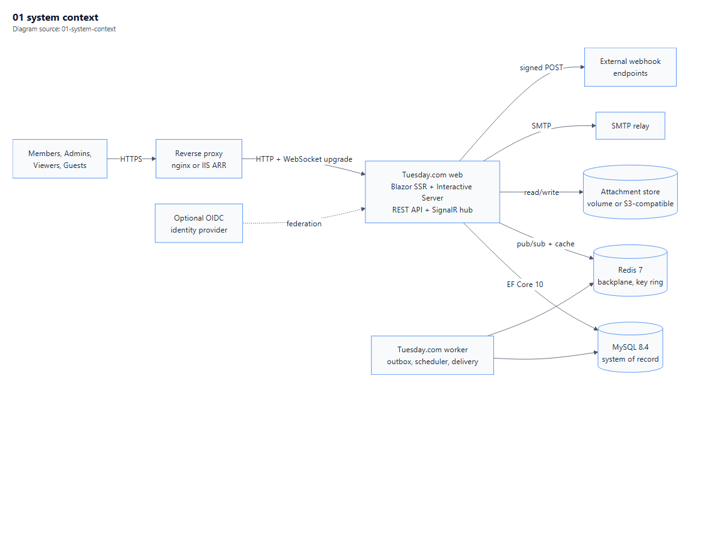
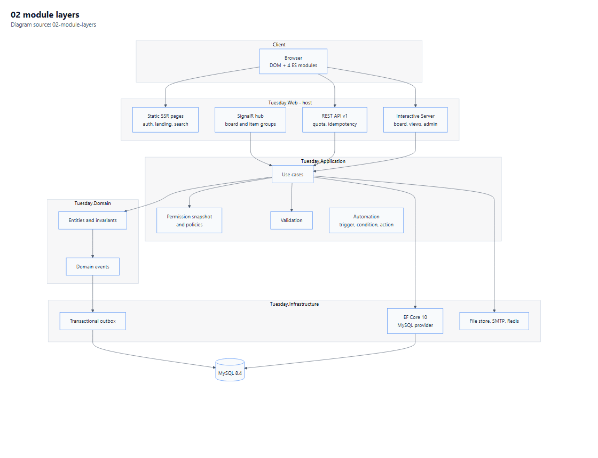
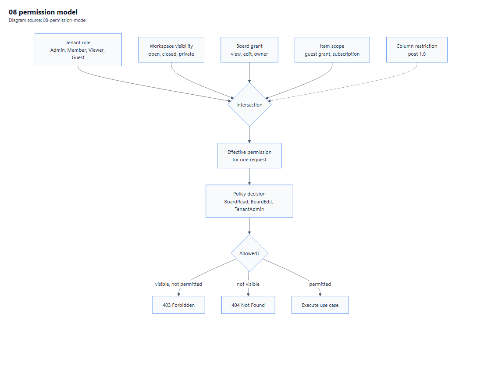
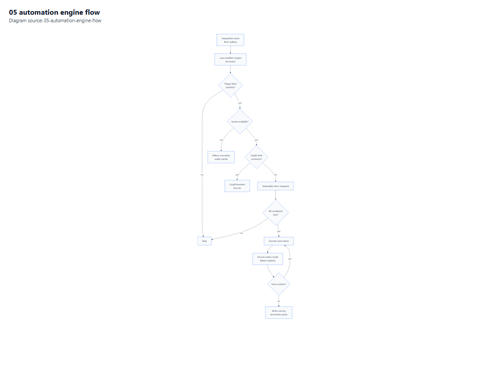
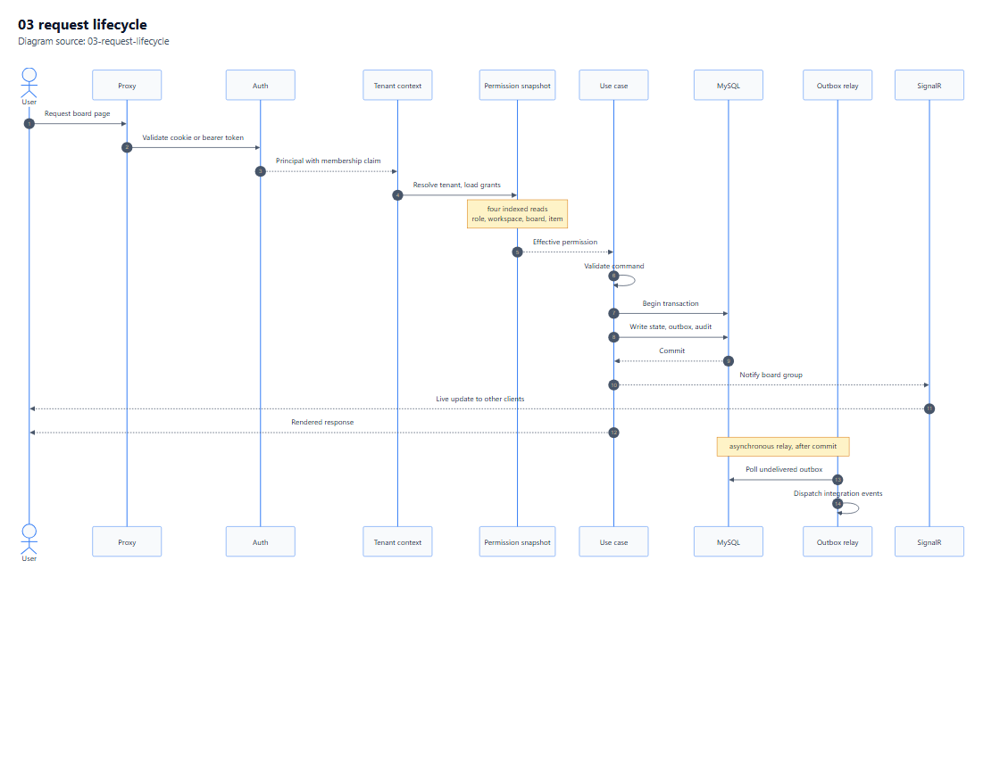

# 02 — Architecture

**Purpose.** The shape of the system: modules, boundaries, tenancy, identity, authorisation, eventing, the automation engine, real-time, and the API. Decisions here are binding on [03](03-Data-Model.md), [04](04-UI-and-UX-Plan.md) and [08](08-Deployment-and-Operations.md).

**Depends on:** [01-Requirements.md](01-Requirements.md) · **Index:** [00-Contents.md](00-Contents.md)

**Diagrams:** [System context](Diagrams/01-system-context.pdf) · [Module & layers](Diagrams/02-module-layers.pdf) · [Request lifecycle](Diagrams/03-request-lifecycle.pdf)

---

## 1. Architectural stance

Five commitments, each with a cost we accept deliberately.

| # | Commitment | We accept |
|---|---|---|
| 1 | **Modular monolith**, one deployable, enforced boundaries | No independent scaling of the automation worker until P5 proves it necessary |
| 2 | **One database schema, tenant discriminator on every root** | A missed filter is a security defect, so isolation is tested adversarially, not reviewed by eye |
| 3 | **Transactionally consistent writes, asynchronous side effects** | Every side effect goes through an outbox; no fire-and-forget HTTP |
| 4 | **Server-rendered UI with per-component interactivity** | Circuits cost server memory; sizing is a deployment concern, not an afterthought |
| 5 | **Behavioural parity, original implementation** | We cannot consult their code, so every behaviour must be re-derived and re-tested from documented observation |

The monolith is not a shortcut. It is the correct shape for a product whose hardest problems are transactional consistency and permission resolution, both of which get *worse* when split across services prematurely.

---

## 2. System context



*Vector version: [01-system-context.pdf](Diagrams/01-system-context.pdf) · source: [01-system-context.mmd](Diagrams/01-system-context.mmd)*

| Actor / system | Relationship |
|---|---|
| **Member / Admin / Viewer / Guest** | Browser over HTTPS; OIDC session; role-scoped capabilities [S5] |
| **Tuesday.com web** | Blazor Web App host; also serves the REST API and the SignalR hub |
| **MySQL 8.4** | System of record, JSON column values, FULLTEXT search index |
| **Redis** | SignalR backplane (required for >1 instance [S17]), distributed cache, Data Protection key ring |
| **Object storage** | Attachments; filesystem volume or S3-compatible [A6] |
| **SMTP relay** | Outbound email notifications [A7] |
| **External endpoints** | Receive our webhooks; must answer the challenge handshake [S12] |
| **Identity provider (optional)** | OIDC federation for enterprise SSO; local accounts always available |

No component is multi-tenant-aware except the application and the database schema. Redis and object storage are partitioned by key prefix, not by instance.

---

## 3. Module boundaries



*Vector: [02-module-layers.pdf](Diagrams/02-module-layers.pdf) · source: [02-module-layers.mmd](Diagrams/02-module-layers.mmd)*

### 3.1 Projects

| Project | Responsibility | May reference |
|---|---|---|
| `Tuesday.Domain` | Entities, value objects, invariants, domain events, permission *rules* | nothing |
| `Tuesday.Application` | Use cases, command/query handlers, validation, authorisation *checks*, outbox contracts | Domain |
| `Tuesday.Infrastructure` | EF Core 10 + MySQL, outbox store, file store, SMTP, Redis, clock | Application, Domain |
| `Tuesday.Web` | Blazor Web App host, REST endpoints, SignalR hub, auth wiring | Application, Infrastructure |
| `Tuesday.Worker` | Scheduled jobs, automation dispatcher, outbox relay, webhook delivery | Application, Infrastructure |
| `Tuesday.Contracts` | DTOs and enums shared with the public API surface | nothing |
| `Tuesday.Tests.*` | Unit, integration, E2E | all |

`Tuesday.Worker` is a separate process but ships in the same container image with a different entry point. That keeps one artefact to version and one migration owner.

### 3.2 Boundary rules (enforced, not advisory)

1. `Domain` has no framework references. Not EF, not ASP.NET Core, not logging abstractions.
2. `Application` never touches `DbContext` types directly; it uses repository interfaces declared beside the use case.
3. Only `Infrastructure` knows the provider is MySQL. This is the escape hatch if D2 is revisited — see [09](09-Risks-and-Open-Questions.md) §2.2.
4. `Web` never contains business rules; a Blazor component that needs a decision calls the application layer.
5. Cross-module calls go through the application layer, never by reaching into another module's tables.

Enforcement: architecture tests that assert assembly references (a test project may reference `NetArchTest`-style assemblies; the assertion itself is the requirement, not the library choice).

### 3.3 Modules inside Application

| Module | Owns |
|---|---|
| **Tenancy** | Account, membership, invitation, tenant context |
| **Workspaces** | Workspace, folder, visibility |
| **Boards** | Board, group, column definition, board type, view configuration |
| **Items** | Item, subitem, ordering, bulk operations, item-level grants |
| **Values** | Column value read/write, per-type validators, projection maintenance |
| **Views** | Query shaping per view (filter/sort/group), saved view state |
| **Collaboration** | Updates, replies, likes, subscriptions, attachments |
| **Notifications** | In-app notification, email digest, delivery preferences |
| **Automation** | Recipe CRUD, trigger registry, condition evaluator, action executor, run log |
| **Integrations** | Webhook subscriptions, delivery, API tokens, OAuth clients |
| **Search** | Indexing projections, query parsing, ranking |
| **Audit** | Append-only event log, hash chain, export |

Each module owns its tables. A foreign key across module boundaries is allowed only to an aggregate *id*, never to another module's mutable state.

---

## 4. Multi-tenancy

### 4.1 Model

**Shared database, shared schema, `TenantId` on every aggregate root** [A1]. Every table that holds tenant data carries `TenantId BINARY(16)` as the leading column of its primary key and of every secondary index that could be scanned.

Layers of defence, in order:

1. **Ambient tenant context** resolved once per request/circuit from the authenticated principal, never from a request parameter.
2. **EF Core global query filter** on every tenant-scoped entity. Fail-closed: if no tenant is resolved, the filter yields nothing rather than everything.
3. **Write-time stamping** in `SaveChanges` interceptor — a mismatched `TenantId` throws rather than silently writing.
4. **Composite indexes** leading with `TenantId`, which makes an unscoped scan slow enough to be caught in review.
5. **Adversarial tests** that attempt cross-tenant reads through every endpoint, run on every build (see [07](07-Testing-Strategy.md) §4.2).

Layers 2 and 5 are the ones that actually hold. Filters can be bypassed with `IgnoreQueryFilters()`; the test suite asserts no production code path calls it (a static analysis rule plus a review checklist item).

### 4.2 Why not database-per-tenant

Database-per-tenant is cleaner isolation but wrong for on-prem: operators run one MySQL instance, and per-tenant databases multiply backup, migration and connection-pool cost. It remains an option for a future hosted edition and is recorded in [09](09-Risks-and-Open-Questions.md) Q7, not designed for now.

### 4.3 Guest tenancy

A guest belongs to the tenant but has **no workspace visibility**. Their access is the union of explicit board grants only [S5][S9]. This is why authorisation cannot be a simple role check — see §5.

---

## 5. Identity and authorisation

### 5.1 Authentication

| Concern | Decision |
|---|---|
| Protocol | OpenID Connect, authorization-code + PKCE for API clients; cookie session for the Blazor app |
| Server | **OpenIddict 7.7.2 (Apache-2.0)** [S19] — chosen over Duende, which is commercial-licensed [S24] |
| User store | ASP.NET Core Identity tables, extended with tenant membership |
| Password policy | Minimum 12 characters, breach-list check, no forced rotation (NIST-aligned) |
| MFA | TOTP, enforceable per tenant, required for `TenantAdmin` |
| API tokens | Personal access tokens, `tue_pat_` prefix, SHA-256 hashed at rest, shown once |
| Machine clients | OAuth client credentials with scoped grants |
| Session | Sliding 8-hour cookie, absolute 7-day cap; server-side revocation list |

The crucial detail: **Blazor Server circuits and the REST API share one authentication stack**, but not one authorisation path. A circuit holds a principal for its lifetime; a token is validated per request. A role change must therefore invalidate circuits — handled by a security-stamp check on each circuit heartbeat, not by hoping the user reconnects.

### 5.2 Authorisation

```
effective_permission(user, resource)
  = tenant_role_capabilities(user, tenant)
  ∩ workspace_visibility(user, workspace)
  ∩ board_grant(user, board)          -- board type + explicit share
  ∩ item_scope(user, item)            -- e.g. guest grant on one item
  ∩ column_restriction(user, column)  -- future: column-level edit locks
```

Intersections, not unions, for anything below board level. The one union is the guest case: a guest's grants are additive across boards, never additive across workspaces.



*Vector: [08-permission-model.pdf](Diagrams/08-permission-model.pdf) · source: [08-permission-model.mmd](Diagrams/08-permission-model.mmd)*

Implementation: ASP.NET Core policy-based authorisation with a resource-based handler. Each application use case declares its requirement (`BoardEdit`, `ItemRead`, `TenantAdmin`, …) and the handler resolves from a pre-loaded permission snapshot for the request, not per-row queries. The snapshot is built once per request from four indexed reads.

**Viewers cannot use the API** [S5] is enforced as: no API scope is ever granted to a principal whose tenant role resolves to `Viewer`. This is checked at token issuance *and* at request authorisation, because a role can change between the two.

### 5.3 Denial behaviour

Authorisation failures return **404 for resources the caller cannot see** and **403 for resources they can see but cannot modify**. Leaking existence is a real risk in a workspace product, and this rule is tested explicitly.

---

## 6. Eventing

### 6.1 Transactional outbox

Every state change that other parts of the system care about writes an `OutboxMessage` **in the same transaction** as the state change. A relay in `Tuesday.Worker` polls, dispatches, and marks delivered.

| Property | Value |
|---|---|
| Delivery guarantee | At-least-once; consumers must be idempotent |
| Ordering | Per aggregate, by monotonic sequence; no global ordering |
| Transport | In-process dispatch now; the outbox table is the seam for a broker later |
| Poison handling | Attempt counter → dead-letter table → operator-visible alert |
| Retention | 7 days delivered, 90 days dead-lettered |

Why not publish directly to Redis or an HTTP call inside the transaction: a crash between commit and publish loses the event, and the automation engine would silently stop working on a busy board. The outbox makes the failure visible and recoverable.

### 6.2 Event taxonomy

| Kind | Example | Consumers |
|---|---|---|
| **Domain event** | `ItemMoved`, `ColumnValueChanged` | In-process, same transaction, no I/O |
| **Integration event** | `ItemCreated`, `StatusChanged` | Outbox → automation engine, webhooks, search indexer, notification fan-out |
| **Audit event** | `BoardPermissionGranted` | Append-only audit log |

A domain event never leaves the transaction. An integration event always does. Conflating the two is how systems end up sending webhooks for rolled-back writes.

---

## 7. Automation engine



*Vector: [05-automation-engine-flow.pdf](Diagrams/05-automation-engine-flow.pdf) · source: [05-automation-engine-flow.mmd](Diagrams/05-automation-engine-flow.mmd)*

### 7.1 Runtime shape

| Stage | Behaviour |
|---|---|
| **Trigger** | Registered handler per trigger kind: `ItemCreated`, `StatusChanged`, `ColumnChanged`, `DateArrived`, `RecurringSchedule`, `ButtonClicked` [S6] |
| **Match** | Load enabled recipes for the board whose trigger kind matches; filter by trigger arguments |
| **Condition** | Evaluate a JSON predicate tree against a materialised item snapshot; AND semantics, no short-circuit side effects |
| **Action** | Execute an ordered action list [S6]; each action isolated — one failure does not abort the rest |
| **Meter** | Increment the tenant's monthly action counter **before** execution; refuse when the plan quota is exhausted [S1] |
| **Log** | `AutomationRun` row per recipe execution with per-action outcome |

### 7.2 Safety properties

1. **Loop prevention.** Every execution carries a depth counter and a correlation id. A recipe that would re-trigger itself beyond depth 3 is stopped and logged. Without this, "when status changes → set status" is an infinite loop that takes the database down.
2. **Idempotency.** Each (recipe, event) pair has a deterministic key; a duplicate delivery is a no-op. Required because the outbox is at-least-once.
3. **Quota enforcement** happens before the action runs, not after, so an exhausted tenant cannot accrue unbounded work.
4. **Failure isolation.** A dead webhook URL does not stop the next action in the recipe.
5. **Importance tie-break** orders competing recipes deterministically [S6].

### 7.3 Scheduling

`scheduled` triggers use **Quartz.NET 4.7.0 (Apache-2.0)** [S19] in persistent-store mode, clustered so two worker instances do not double-fire. Hangfire was rejected: it is **LGPL-3.0** [S22], which is workable but adds a redistribution obligation for no functional gain here.

Date-arrival triggers ("when a date arrives" [S6]) are evaluated by a periodic sweep with a per-tenant watermark, not by one scheduled job per item. A million items cannot imply a million jobs.

---

## 8. Real-time

| Concern | Decision |
|---|---|
| Transport | SignalR over WebSockets; long-polling fallback only where a proxy blocks upgrade |
| Grouping | `board:{boardId}` for board-level events, `item:{itemId}` for open item panels, `user:{userId}` for notifications |
| Payload | Minimal: entity id, change kind, version stamp. Clients fetch the authoritative row if they need it |
| Presence | Ephemeral keys in Redis with TTL; never persisted |
| Scale-out | **Redis backplane required above one instance** [S17] |
| Session affinity | **Sticky sessions required** even with the backplane [S17] — this is the single most commonly missed deployment requirement |
| Backpressure | Per-connection send queue with drop-oldest for presence events, never for value changes |
| Reconnect | Client re-syncs by last-seen version, not by replaying a buffer |

The last row matters: a reconnecting client asking "what changed since version N" is robust; a client relying on a server-side event buffer is not.

---

## 9. API design

### 9.1 Shape

REST/JSON, versioned by URL segment (`/api/v1/...`) with a separate contract version cadence matching the quarterly public rhythm [S26] [A9].

| Concern | Decision |
|---|---|
| Pagination | Opaque cursor over `(PositionKey, Id)`; no offset paging on boards |
| Resource addressing | `/boards/{id}/items`, `/boards/{id}/columns`, `/items/{id}/values/{columnId}` |
| Bulk | Batched value updates per item, max 50 columns per call |
| Errors | RFC 9457 problem+json, stable `code`, `retry_in_seconds` on throttling [S11] |
| Idempotency | `Idempotency-Key` header, 30-minute response cache, replay marker, 409 on concurrent duplicate [S25] |
| Quotas | Daily call counter per token, per-minute sliding window, per-query cost ceiling [S11] |
| Auth | Bearer JWT or PAT; `Viewer` never issues a usable token [S5] |

### 9.2 Cost model

Rather than counting calls only, each request computes a **cost** from returned row counts and relation depth, capped per query. This mirrors the documented complexity model [S11] closely enough that operators recognise the behaviour, without claiming to reproduce their arithmetic.

| Limit | Value | Source |
|---|---|---|
| Single-request cost ceiling | 5,000,000 points | [S11] |
| Per-minute read budget | 5M (app tokens) | [S11] |
| Per-minute write budget | 5M (app tokens) | [S11] |
| Daily calls | Tier-dependent, 200 → 25,000 | [S11] |

### 9.3 Idempotency store

A table keyed by `(TenantId, TokenId, IdempotencyKey)` holding the response hash, status and a 30-minute expiry. A background sweep removes expired rows. Concurrent duplicates return 409 with `Retry-After` [S25].

---

## 10. Request lifecycle



*Vector: [03-request-lifecycle.pdf](Diagrams/03-request-lifecycle.pdf) · source: [03-request-lifecycle.mmd](Diagrams/03-request-lifecycle.mmd)*

1. **TLS termination** at the reverse proxy (nginx in Compose, IIS/ARR on Windows Server).
2. **Authentication** — cookie or bearer; principal built once.
3. **Tenant resolution** — from the principal's active membership claim; never from a header or route value.
4. **Permission snapshot** — four indexed reads: tenant role, workspace grants, board grants, item grants.
5. **Use-case dispatch** — an in-house dispatcher (see §11.1) selects the handler.
6. **Validation** — FluentValidation 12.2.0 (Apache-2.0) [S19], running before any state read that could leak existence.
7. **Transaction** — state change + outbox row + audit row commit together.
8. **Post-commit** — SignalR notify (fire, best-effort), outbox relay picks up integration events.
9. **Response** — rendered component or JSON, with correlation id echoed.

Step 8 being after the commit is the whole point: no notification for a rolled-back write.

---

## 11. Stack decisions and licences

Versions verified against the NuGet registration API on 3 Nov 2026 [S19].

### 11.1 Chosen

| Concern | Package | Version | Licence | Note |
|---|---|---|---|---|
| Runtime | .NET | **10.0 (LTS)** | MIT | Supported to 14 Nov 2028 [S15] |
| Web | ASP.NET Core | 10.0 | MIT | Shared framework |
| UI | Blazor Web App | 10.0 | MIT | D3 |
| Components | **MudBlazor** | 9.12.0 | MIT | Grid primitives, dialogs, theming |
| Components (alt) | Radzen.Blazor | 12.1.10 | MIT | Fallback for specific controls |
| ORM | **Microsoft.EntityFrameworkCore** | **10.0.14** | MIT | D2 |
| Database provider | **Npgsql.EntityFrameworkCore.PostgreSQL** | **10.0.0** | **MIT** | PostgreSQL 17 is the system of record; supersedes the MySQL row below (see §11.3) |
| MySQL provider (superseded) | MySql.EntityFrameworkCore (Oracle) | **10.0.12** | **GPLv2 + FOSS exception** | Replaced by PostgreSQL; licence risk closed |
| ADO driver | MySqlConnector | 2.6.2 | MIT | Used directly for reporting queries |
| Identity server | **OpenIddict** | 7.7.2 | Apache-2.0 | Over Duende [S24] |
| Validation | FluentValidation | 12.2.0 | Apache-2.0 | |
| Mapping | **Riok.Mapperly** | 4.3.1 | Apache-2.0 | Source generator; replaces AutoMapper, which is now RPL/commercial [S23] |
| Scheduling | **Quartz.NET** | 4.7.0 | Apache-2.0 | Over Hangfire (LGPL) [S22] |
| Real-time | SignalR + StackExchangeRedis | 10.0.14 | MIT | Backplane [S17] |
| Resilience | Polly | 8.9.0 | BSD-3-Clause | Retry, circuit breaker |
| HTTP client | Refit | 16.4.0 | MIT | Typed clients for webhook delivery |
| Telemetry | OpenTelemetry.Extensions.Hosting | 1.20.1 | Apache-2.0 | Traces + metrics |
| Logging | Serilog.AspNetCore | 10.0.1 | Apache-2.0 | Structured logs |

### 11.2 Rejected, and why

| Package | Reason |
|---|---|
| **MediatR 14** | RPL-1.5 or paid licence [S21]. Last permissive: 12.5.0 (Apache-2.0). We use a ~150-line in-house dispatcher instead of pinning an EOL major. |
| **AutoMapper 16** | Same RPL change [S23]. Last permissive 14.0.0. Mapperly's compile-time mapping is also faster. |
| **MassTransit 9** | Commercial licence. Last Apache-2.0: 8.5.12. We do not need a broker at this scale; the outbox is sufficient. |
| **Hangfire** | LGPL-3.0 [S22]. Acceptable, but Quartz is Apache-2.0 and we need clustering, not a dashboard. |
| **Duende.IdentityServer** | Commercial licence [S24]. OpenIddict covers the requirement. |
| **FluentAssertions 8** | Commercial since 8.x; last free 7.2.2 [S19]. Tests use xUnit v3 assertions. |
| **Pomelo MySQL provider** | No EF Core 10 build; issue #2007 open [S20]. The MIT option is unavailable *today*, which is the whole reason D2 costs money. |

### 11.3 The MySQL provider decision, stated plainly

D2 selects Oracle's provider because it is the only EF Core 10-compatible MySQL option as of 3 Nov 2026 [S19][S20]. Its licence is **GPLv2 with a FOSS exception**. For a closed-source distribution this implies a commercial MySQL connector licence from Oracle.

Three mitigations are documented, in preference order:

1. **Budget the licence.** Simplest, and the plan of record.
2. **Contain the provider** behind `Infrastructure` so switching is a one-project change (§3.2 rule 3).
3. **Keep a Dapper/MySqlConnector (MIT) path** for hot read queries, so a future provider swap does not require rewriting the grid.

This is a real cost of D2, and [01](01-Requirements.md) §6.3 quantifies the alternative honestly.

---

## 12. What this architecture deliberately does not do

| Not done | Consequence | Revisit when |
|---|---|---|
| Microservices | Single deployable; automation shares the database | Automation throughput saturates the worker |
| CQRS with separate read store | Reads hit MySQL through projections | Board read latency breaks NFR-1 |
| Event sourcing | State is authoritative; events are notifications | Audit requires full reconstruction |
| GraphQL | REST only [A9] | Client demand justifies it (Q2) |
| Per-tenant databases | Shared schema + discriminator | Hosted multi-tenant edition |
| CRDT co-editing | Last-write-wins with conflict notice | Concurrent same-cell editing becomes common |

Each of these is a place where a reviewer might reasonably disagree. The reasoning is recorded so the disagreement can be specific.

---

**Next:** [03-Data-Model.md](03-Data-Model.md) turns the domain into MySQL tables, indexes and migrations.
