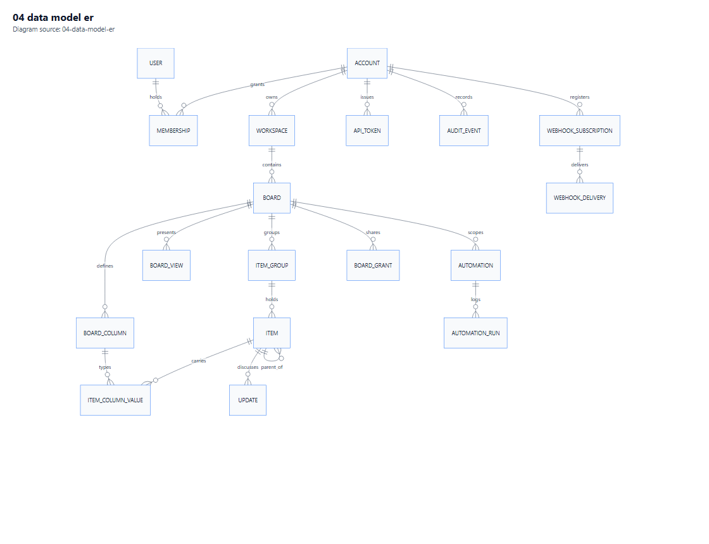

# 03 — Data Model

**Purpose.** The MySQL 8.4 schema, the strategy that makes 29 dynamic column types fit one model, indexing, concurrency, and migrations.

**Depends on:** [02-Architecture.md](02-Architecture.md) · **Feeds:** [04-UI-and-UX-Plan.md](04-UI-and-UX-Plan.md), [06](06-Integrations-and-Extensibility.md) · **Index:** [00-Contents.md](00-Contents.md)

**Diagram:** [Data model (ER)](Diagrams/04-data-model-er.pdf)

---

## 1. The central problem

A board defines its own columns at runtime. An item's values are therefore **not** a fixed row shape. Two items on different boards share nothing structurally, yet must sort, filter, aggregate and validate identically fast.

Every candidate solution trades one of: query flexibility, write amplification, schema churn, or type safety. The choice below is the one that survives all four requirements at this product's scale [A2].

---

## 2. Conventions

| Concern | Convention | Reason |
|---|---|---|
| Primary keys | `BINARY(16)`, UUIDv7 generated in application code | Time-ordered values keep InnoDB clustered inserts sequential; `CHAR(36)` would waste 20 bytes per key per index |
| Timestamps | `DATETIME(6)` in UTC [A4] | MySQL `TIMESTAMP` has a 2038 ceiling and implicit timezone conversion — both are bugs waiting |
| Date-only columns | `DATE` | A date column is a calendar date, not an instant |
| Strings | `utf8mb4` / `utf8mb4_0900_ai_ci` | Default in 8.4; emoji-safe |
| Money/decimals | `DECIMAL(19,6)` | Never `DOUBLE` for anything a user sums |
| Booleans | `TINYINT(1)` | MySQL has no native boolean |
| Enum-like | `VARCHAR(32)` + `CHECK` constraint | Adding a value must not rewrite a table |
| Soft delete | `DeletedAt DATETIME(6) NULL` | Needed for restore and audit; filtered indexes are not a MySQL feature, so the query layer must add the predicate |
| Row version | `Version INT NOT NULL DEFAULT 0` | Optimistic concurrency; MySQL has no `rowversion` |
| Tenant key | `TenantId BINARY(16)` first in every composite index | Keeps tenant scans cheap and accidental global scans slow |

**Engine:** InnoDB everywhere, `ROW_FORMAT=DYNAMIC`. No MyISAM, ever — it has no transactions and no crash safety.

---

## 3. Entity map

*Vector: [04-data-model-er.pdf](Diagrams/04-data-model-er.pdf) · source: [04-data-model-er.mmd](Diagrams/04-data-model-er.mmd)*

### 3.1 Identity and tenancy

| Table | Key columns | Notes |
|---|---|---|
| `Account` | `Id`, `Name`, `Slug`, `PlanTier`, `Timezone`, `CreatedAt` | Tenant root. `PlanTier` drives quotas [S1] |
| `User` | `Id`, `Email` (unique), `DisplayName`, `PasswordHash`, `SecurityStamp`, `MfaEnabled` | Global, not tenant-scoped — one human may belong to two tenants |
| `Membership` | `TenantId`, `UserId`, `Role`, `JoinedAt`, `InvitedBy` | PK `(TenantId, UserId)`. Role ∈ Admin/Member/Viewer/Guest [S5] |
| `Team` | `TenantId`, `Id`, `Name` | People-column target |
| `TeamMember` | `TenantId`, `TeamId`, `UserId` | |
| `Session` | `Id`, `UserId`, `SecurityStamp`, `ExpiresAt`, `RevokedAt` | Enables forced logout on role change |

`User` being global while `Membership` is tenant-scoped is deliberate: it avoids duplicate accounts for consultants, and it means **email is unique globally**, which is a constraint operators must be told about.

### 3.2 Workspaces and boards

| Table | Key columns | Notes |
|---|---|---|
| `Workspace` | `TenantId`, `Id`, `Name`, `Visibility`, `CreatedBy` | Visibility ∈ Open/Closed/Private |
| `Folder` | `TenantId`, `Id`, `WorkspaceId`, `ParentFolderId`, `Name` | One level of nesting at launch |
| `Board` | `TenantId`, `Id`, `WorkspaceId`, `FolderId`, `Name`, `BoardType`, `Description`, `OwnerUserId`, `PositionKey` | `BoardType` ∈ Main/Shareable/Private [S9] |
| `BoardGrant` | `TenantId`, `BoardId`, `PrincipalType`, `PrincipalId`, `Access` | `Access` ∈ View/Edit/Owner; principal is user, team or guest |
| `BoardColumn` | `TenantId`, `BoardId`, `Id`, `Type`, `Title`, `Description`, `SettingsJson`, `PositionKey`, `IsArchived` | **Max 500 per board** enforced in the application [S3] |
| `ItemGroup` | `TenantId`, `BoardId`, `Id`, `Title`, `ColorToken`, `PositionKey`, `IsCollapsed` | Colour is a token, not a hex value — theming stays ours |
| `BoardView` | `TenantId`, `BoardId`, `Id`, `ViewType`, `Name`, `ConfigJson`, `PositionKey`, `CreatedBy` | **Max 100 per board** [S7] |

Two constraints are worth stating as invariants rather than schema:

- A board's `BoardType` may change (main → private) but never its `WorkspaceId`.
- `BoardColumn.Type` is **immutable** after creation. Changing a column's type is a data migration, not an update — the product exposes it as "create a new column", which is also what the public behaviour implies [S3].

### 3.3 Items and hierarchy

| Table | Key columns | Notes |
|---|---|---|
| `Item` | `TenantId`, `BoardId`, `Id`, `GroupId`, `ParentItemId`, `Name`, `PositionKey`, `CreatedAt`, `CreatedBy`, `UpdatedAt`, `Version`, `DeletedAt` | `ParentItemId` null for top-level; set for subitems |
| `SubitemBoard` | `TenantId`, `BoardId`, `Id`, `Title` | One implicit board per parent board [S8] |
| `BoardRelation` | `TenantId`, `Id`, `SourceBoardId`, `SourceItemId`, `TargetBoardId`, `TargetItemId`, `IsTwoWay` | Backs `board_relation` [S2] |
| `ItemDependency` | `TenantId`, `Id`, `BoardId`, `PredecessorItemId`, `SuccessorItemId`, `LagDays` | Backs `dependency` [S2]; cycle check on write |

**Subitem storage.** Subitems live in `Item` with `ParentItemId` set, and their column definitions live in `BoardColumn` scoped to the subitem board's id. This keeps one query path for both levels and one permission model. Depth is capped at 2 [01](01-Requirements.md) §5.

Consequence to accept: `Item.BoardId` for a subitem points at the **child** board, so any board-wide aggregate must join through the child board's parent link. That is recorded in the `SubitemBoard` row and used by every aggregate — see §7.3.

### 3.4 Collaboration and notifications

| Table | Key columns | Notes |
|---|---|---|
| `Update` | `TenantId`, `ItemId`, `Id`, `AuthorId`, `BodyHtml`, `BodyText`, `CreatedAt`, `EditedAt`, `DeletedAt` | Body sanitised on write, stored twice (safe HTML + plain text for search) |
| `UpdateReply` | `TenantId`, `UpdateId`, `Id`, `AuthorId`, `BodyText`, `CreatedAt` | |
| `UpdateLike` | `TenantId`, `UpdateId`, `UserId` | PK `(UpdateId, UserId)` |
| `Attachment` | `TenantId`, `Id`, `OwnerType`, `OwnerId`, `FileName`, `ContentType`, `ByteSize`, `StorageKey`, `Checksum` | Binaries outside MySQL [A6] |
| `Subscription` | `TenantId`, `Id`, `UserId`, `TargetType`, `TargetId`, `Mode` | Mode ∈ All/Assigned/Mentions |
| `Notification` | `TenantId`, `Id`, `UserId`, `Kind`, `PayloadJson`, `ReadAt`, `CreatedAt` | |
| `NotificationPreference` | `TenantId`, `UserId`, `Kind`, `InApp`, `Email` | |

### 3.5 Automation, integrations, audit

| Table | Key columns | Notes |
|---|---|---|
| `Automation` | `TenantId`, `Id`, `BoardId`, `Name`, `TriggerJson`, `ConditionsJson`, `ActionsJson`, `IsEnabled`, `Importance`, `CreatedBy`, `DeletedAt` | Recipe = trigger + conditions + ordered actions [S6] |
| `AutomationRun` | `TenantId`, `Id`, `AutomationId`, `EventId`, `StartedAt`, `FinishedAt`, `Status`, `Depth`, `ActionResultsJson` | One row per execution |
| `AutomationQuota` | `TenantId`, `PeriodStart`, `ActionsUsed`, `Limit` | Monthly counter [S1] |
| `WebhookSubscription` | `TenantId`, `Id`, `BoardId`, `Url`, `Secret`, `EventsJson`, `IsActive`, `VerifiedAt` | `VerifiedAt` set only after handshake [S12] |
| `WebhookDelivery` | `TenantId`, `Id`, `SubscriptionId`, `EventId`, `Attempt`, `StatusCode`, `ResponseSnippet`, `NextRetryAt`, `Status` | |
| `ApiToken` | `TenantId`, `Id`, `UserId`, `Name`, `TokenHash`, `Prefix`, `Scopes`, `LastUsedAt`, `ExpiresAt`, `RevokedAt` | Hash only; plaintext shown once |
| `OAuthClient` | `TenantId`, `Id`, `ClientId`, `SecretHash`, `RedirectUris`, `Scopes` | For third-party apps |
| `IdempotencyRecord` | `TenantId`, `TokenId`, `Key`, `RequestHash`, `ResponseJson`, `StatusCode`, `CreatedAt`, `ExpiresAt` | 30-minute window [S25] |
| `AuditEvent` | `TenantId`, `Id`, `OccurredAt`, `ActorId`, `Action`, `TargetType`, `TargetId`, `BeforeJson`, `AfterJson`, `CorrelationId`, `PrevHash`, `Hash` | Append-only, hash-chained |
| `OutboxMessage` | `TenantId`, `Id`, `Type`, `PayloadJson`, `OccurredAt`, `DispatchedAt`, `Attempts`, `LastError` | §6 of [02](02-Architecture.md) |

---

## 4. The column-value strategy

### 4.1 Options considered

| Option | Read a board | Filter by column | Add a column type | Verdict |
|---|---|---|---|---|
| **A. Table per type** | 29-way join or 29 queries | Native, indexed | New table + migration per type | Rejected: query explosion |
| **B. EAV (row per field)** | Pivot 500×N rows | Works with indexes | None | Rejected: pivot cost at 20k items |
| **C. Pure JSON blob per item** | One row, one read | Needs generated columns or JSON path scans | None | Rejected alone: range filters degrade |
| **D. JSON + typed projections** | One row, one read | Indexed on projections | None | **Chosen** |

### 4.2 Chosen design

One row per (item, column) in `ItemColumnValue`, with the canonical payload in JSON and **typed projection columns** maintained on write.

| Column | Type | Purpose |
|---|---|---|
| `TenantId` | `BINARY(16)` | Isolation |
| `ItemId` | `BINARY(16)` | FK |
| `ColumnId` | `BINARY(16)` | FK |
| `BoardId` | `BINARY(16)` | Denormalised: avoids a join on every board read |
| `ValueJson` | `JSON` | Canonical, lossless, format-tolerant |
| `ValueText` | `VARCHAR(1024)` | Equality + prefix search |
| `ValueTextFull` | `TEXT` (in separate table) | Long text, off the hot row |
| `ValueNumber` | `DECIMAL(19,6)` | Numeric sort/filter/aggregate |
| `ValueDate` | `DATE` | Start date |
| `ValueDateEnd` | `DATE` | End date for timeline/range |
| `ValueStatusIndex` | `SMALLINT` | Ordinal position of a status label |
| `ValueBool` | `TINYINT(1)` | Checkbox/button state |
| `ValuePersonIds` | `JSON` | Array, multi-valued index |
| `ValueRefIds` | `JSON` | Array of related item ids |
| `UpdatedAt`, `Version` | | Change tracking |

Primary key `(TenantId, ItemId, ColumnId)`. This makes an item read a single range scan and a cell update a single row write.

### 4.3 Projection rules per type

| Type family | Projection used | Index |
|---|---|---|
| `text`, `email`, `phone`, `link`, `name` | `ValueText` | `(TenantId, BoardId, ColumnId, ValueText(191))` |
| `long_text`, `doc` | `ValueTextFull` | FULLTEXT |
| `numbers`, `rating`, `hour`, `vote`, `time_tracking`, `progress` | `ValueNumber` | `(TenantId, BoardId, ColumnId, ValueNumber)` |
| `status`, `dropdown`, `color_picker` | `ValueText` + `ValueStatusIndex` | Composite for Kanban grouping [S4] |
| `date`, `week`, `world_clock` | `ValueDate` | `(TenantId, BoardId, ColumnId, ValueDate)` |
| `timeline` | `ValueDate` + `ValueDateEnd` | Range scan on the pair |
| `checkbox`, `button` | `ValueBool` | Composite |
| `people`, `tags` | `ValuePersonIds` | **Multi-valued index** on the JSON array |
| `board_relation`, `dependency` | `ValueRefIds` | Multi-valued index |
| `location`, `country` | `ValueText` (code) + JSON lat/long | Prefix on code |
| `file` | `ValueJson` only | No index; files are read with the item |
| Read-only (`formula`, `mirror`, `creation_log`, `last_updated`, `item_id`) | None | Computed at read; never stored [S2] |
| `auto_number` | `ValueNumber` | Calculated at insert; immutable afterwards |

A **stored generated column** on `ItemColumnValue` could derive `ValueStatusIndex` from JSON, but the mapping from label to ordinal lives in `BoardColumn.SettingsJson`, which a generated column cannot read. So projections are written by the application in one place — the value writer — and a consistency test asserts they match the JSON.

### 4.4 Why JSON stays canonical

If projections were canonical, every new column type would need a schema change, and a type's richer payload (location coordinates, file metadata, doc references) would not fit. JSON keeps fidelity; projections keep queries fast.

The cost is a **two-writer problem**: any code path that touches `ValueJson` must also update projections. This is enforced by making the value writer the only allowed mutation surface (architecture test: no other code may assign these columns) and by a nightly reconciliation job that samples 1,000 rows per board and reports mismatches.

### 4.5 Status label ordering

Status columns order their labels, and Kanban columns derive from label order [S4]. The ordinal is stored in `ValueStatusIndex` so sorting and grouping never parse JSON at query time. Renaming a label keeps its ordinal; reordering labels rewrites affected rows in a background job — a known write burst, bounded by board size and documented as an operation.

---

## 5. Ordering

Board ordering uses **fractional index strings** (LexoRank-style: base-62 strings that sort lexicographically and admit a value between any two).

| Table | Column | Why not an integer |
|---|---|---|
| `Item` | `PositionKey` | Reordering one row must not renumber its siblings |
| `ItemGroup` | `PositionKey` | Same |
| `BoardColumn` | `PositionKey` | Column insertion in the middle is common |
| `BoardView` | `PositionKey` | Same |

Rules:

- Keys are generated at the midpoint between neighbours; a gap is always available.
- Keys grow in length under repeated midpoint insertion; a **rebalance job** rewrites a board's keys when any key exceeds 64 characters.
- Sorting is `ORDER BY PositionKey, Id` — the `Id` tie-break makes pagination deterministic when two rows share a key.

Integer positions were rejected because a single drag in a 20,000-item group would rewrite 20,000 rows and invalidate every concurrent reader's cursor.

---

## 6. Indexing

### 6.1 Index set

| Index | Table | Columns | Serves |
|---|---|---|---|
| `IX_Item_Board_Group_Pos` | `Item` | `(TenantId, BoardId, GroupId, PositionKey, Id)` | Table view page load |
| `IX_Item_Board_Parent` | `Item` | `(TenantId, BoardId, ParentItemId, PositionKey)` | Subitem expansion |
| `IX_Value_Board_Column_Status` | `ItemColumnValue` | `(TenantId, BoardId, ColumnId, ValueStatusIndex)` | Kanban grouping |
| `IX_Value_Board_Column_Date` | `ItemColumnValue` | `(TenantId, BoardId, ColumnId, ValueDate, ValueDateEnd)` | Calendar/timeline range |
| `IX_Value_Board_Column_Num` | `ItemColumnValue` | `(TenantId, BoardId, ColumnId, ValueNumber)` | Numeric filters |
| `IX_Value_People_MV` | `ItemColumnValue` | Multi-valued on `ValuePersonIds` | "Items assigned to me" |
| `IX_Value_Refs_MV` | `ItemColumnValue` | Multi-valued on `ValueRefIds` | Relation lookups |
| `FT_Item_Name` | `Item` | FULLTEXT `Name` | Search |
| `FT_Update_Body` | `Update` | FULLTEXT `BodyText` | Search |
| `IX_Outbox_Pending` | `OutboxMessage` | `(DispatchedAt, OccurredAt)` | Relay poll |
| `IX_Audit_Target` | `AuditEvent` | `(TenantId, TargetType, TargetId, OccurredAt)` | Item history |
| `IX_Notif_User_Unread` | `Notification` | `(TenantId, UserId, ReadAt, CreatedAt)` | Bell badge |

### 6.2 Multi-valued indexes

MySQL 8.0.17+ supports indexing a JSON array directly, which is what makes `people` and `tags` filterable without a join table:

- The array elements are typed (`UNSIGNED` for ids).
- One index entry is created per array element — this is why an item with 50 assignees costs 50 index entries. Acceptable at the documented cardinality; it would not be at 5,000.
- Documents must be `MEMBER OF` or `JSON_CONTAINS` predicates; a `LIKE` on the JSON text will not use the index.

A join table (`ItemPerson`) was the alternative. It is more portable and indexes better for "all items of person X", but it adds a second write path per value change and doubles the row count of the hottest table. Multi-valued index wins on write cost, which is the binding constraint during bulk imports.

### 6.3 FULLTEXT and language

`ngram` parser is required for substring matching in CJK text; the default parser tokenises on whitespace and would fail there. Until localisation is in scope [A5], the default parser is used and the ngram switch is documented as a deployment flag, not a schema change.

`innodb_ft_min_token_size` defaults to 3. Terms shorter than that are not indexed — a real behavioural difference from naive expectations, and the reason search results for two-letter queries will look empty.

### 6.4 Things MySQL will not do

| Wanted | Reality | Workaround |
|---|---|---|
| Partial/filtered index | Not supported | Include the predicate column in the index |
| Index on `TEXT` without prefix | Only with FULLTEXT | Prefix length or a separate hash column |
| Native `UUID` type | None | `BINARY(16)` |
| `rowversion` | None | `Version INT` + optimistic concurrency |
| Transactional DDL | Single statements are atomic, batches are not | Expand/contract migrations (§9.2) |
| `jsonb` GIN indexes | JSON + multi-valued only | Projection columns |

---

## 7. Query patterns

### 7.1 Table view page

One query for items ordered by `(GroupId, PositionKey)`, one query for the values of those items, joined in memory. The alternative — a join with 29 conditional projections — is slower and harder to keep correct.

### 7.2 Kanban

Group by `ValueStatusIndex` for the chosen status column [S4]; card fields fetched from the projections named in the view config. "Divide by" adds a second grouping key (group id, status, or relation target) [S4].

### 7.3 Aggregates and mirrors

`mirror` columns read across a relation; `formula` columns evaluate a stored expression [S2]. Both are computed at read time from a materialised item snapshot, never stored — matching their read-only nature [S2]. Aggregates at group footers [S3] run as a single grouped query over projections, bounded to the visible page plus a separate "total" query.

### 7.4 Search

Union of FULLTEXT hits on item names and update bodies, filtered by the permission snapshot, ranked by recency × term frequency. Results are capped at 200 with a cursor; a user searching for a common word gets fast, bounded results rather than a slow complete answer.

---

## 8. Concurrency

| Mechanism | Use |
|---|---|
| Optimistic concurrency on `Version` | Every item and column-value update; `WHERE Version = @expected`, 0 rows affected = 409 |
| Row locks (`SELECT ... FOR UPDATE`) | Only in the automation engine when metering quota |
| Advisory locks (`GET_LOCK`) | Migration runner and rebalance jobs — single-runner guarantees without a coordination service |
| Transaction isolation | `READ COMMITTED` |

`READ COMMITTED` rather than the MySQL default `REPEATABLE READ`: gap locking under repeatable read causes deadlocks in a workload that constantly inserts items at the end of a group. The cost is phantom reads within a transaction, which this design never relies on.

---

## 9. Migrations

### 9.1 Tooling

EF Core 10 migrations, one migrations assembly (`Tuesday.Infrastructure`), generated per provider. Every migration is reviewed for:

1. Whether it takes a table lock long enough to matter.
2. Whether it is reversible, or explicitly marked destructive.
3. Whether it depends on a data backfill that must run separately.

### 9.2 Expand/contract, always

Because DDL batches are not transactional in MySQL, every schema change follows three deploys:

| Step | Deploy | Content |
|---|---|---|
| Expand | N | Add nullable column / new table / new index (online where supported) |
| Migrate | N+1 | Backfill in batches of 5,000 with a sleep between; verify counts |
| Contract | N+2 | Add constraint, drop old column |

A single-deploy "rename column" is prohibited by review rule: it takes an instantaneous DDL that breaks the previous application version still serving traffic during a rolling deploy.

### 9.3 Baseline and seeding

- A **baseline migration** creates the schema for a fresh install in one pass, for operators who start empty.
- Seed data is limited to: one tenant, one admin, default status label sets, and the column-type registry rows. No demo boards — a demo board in production is a support incident.
- `dotnet ef migrations script --idempotent` output is the artefact operators run, not the runtime migrator. Runtime auto-migration on startup is disabled, because two instances starting together will race.

### 9.4 Rollback

Schema rollback is **forward-only** in practice: the contract step is the point of no return, and rollback means restoring the pre-deploy backup (see [08](08-Deployment-and-Operations.md) §10). This is stated plainly so nobody plans a `Down()` that has never been executed against production data.

---

## 10. Capacity and growth

| Table | Growth driver | 1-year estimate at [A2] | Mitigation |
|---|---|---|---|
| `Item` | Boards × items | 5–20M rows | Partition by `TenantId` hash if > 50M |
| `ItemColumnValue` | Items × populated columns | 50–200M rows | The hot table; projection-only indexes, archive closed boards |
| `AuditEvent` | Every mutation | 100M+ rows | Monthly partitions, 24-month hot window (Q5) |
| `AutomationRun` | Every execution | 10–50M rows | 90-day retention, then aggregate |
| `OutboxMessage` | Every event | Bursts of 100k | Purge delivered after 7 days |
| `Notification` | Every fan-out | 20M rows | Delete read notifications after 90 days |

`ItemColumnValue` is the table that decides whether this design holds. Two rules protect it: nothing but the value writer touches it, and closed boards are archived to a cold table after 12 months of inactivity.

---

## 11. Data-handling rules

1. **No cross-tenant foreign keys.** A FK may reference `Account.Id`, never another tenant's row implicitly.
2. **No hard deletes** of user-visible entities; `DeletedAt` plus a purge job after 30 days.
3. **Personal data** (email, display name) is confined to `User`, `Membership`, `Update`, `Attachment` — the four tables an export or erasure request must touch.
4. **Attachments are never served from the database**; the API issues short-lived signed URLs.
5. **Backups contain personal data** and inherit the same access controls as production ([08](08-Deployment-and-Operations.md) §9.4).

---

**Next:** [04-UI-and-UX-Plan.md](04-UI-and-UX-Plan.md) maps this model onto Blazor components and render modes.
