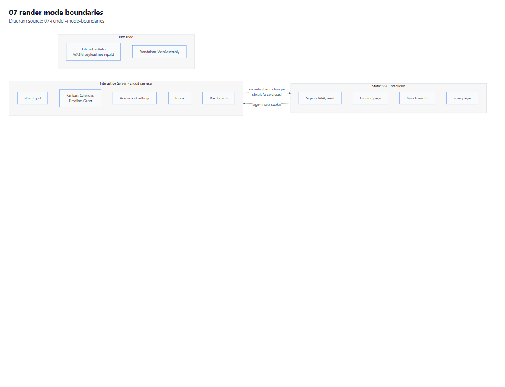

# 04 — UI and UX Plan

**Purpose.** Render mode allocation, routes, component boundaries, JavaScript interoperability, the board grid's interaction model, and the method for achieving behavioural parity without copying design.

**Depends on:** [02-Architecture.md](02-Architecture.md), [03-Data-Model.md](03-Data-Model.md) · **Constrained by:** [05](05-Security-and-Compliance.md), [11](11-Clean-Room-Protocol.md) · **Index:** [00-Contents.md](00-Contents.md)

**Diagrams:** [Render-mode boundaries](Diagrams/07-render-mode-boundaries.pdf) · [Request lifecycle](Diagrams/03-request-lifecycle.pdf)

---

## 1. Hosting and render-mode allocation

**Decision D3.** One Blazor Web App project. Render mode is chosen per page, not per app.

| Surface | Render mode | Why |
|---|---|---|
| Sign-in, MFA, password reset | **Static SSR** | No circuit needed; fastest first paint; works with `HttpContext` cookie sign-in directly [S16] |
| Marketing / landing | Static SSR | Crawlable, cacheable |
| Workspace shell (nav, breadcrumb) | Static SSR + Interactive Server islands | Shell renders instantly; only the parts that change are interactive |
| Board page (grid, group bands, item panel) | **Interactive Server** | Dense, stateful, keyboard-driven; server holds the model, client holds only the DOM |
| View tabs (Kanban/Calendar/Timeline/Gantt) | Interactive Server | Drag operations need low-latency server round-trips with optimistic UI |
| Admin & settings | Interactive Server | Forms with validation against live data |
| Search results | Static SSR with a GET query | Shareable, bookmarkable URLs; no circuit for a read-only list |
| Error pages | Static SSR | Must render when the circuit is dead — this is why they are never interactive |

### 1.1 Wiring requirements

Making Interactive Server work is not just an attribute [S16]:

1. `AddInteractiveServerComponents()` registers the services.
2. `AddInteractiveServerRenderMode()` maps the endpoint.
3. The render mode is applied at `Routes` or on individual pages — **never on the `App` root**, which cannot be interactive [S16].
4. `HeadOutlet` is aligned with the same mode, or head content silently fails to update on navigation.
5. Components prerender by default. A blank first frame does **not** prove interactivity is broken [S16].

`InteractiveAuto` is deliberately not used. It would download a WebAssembly payload to every board user to save a server round-trip that the design already hides behind optimistic UI. The bandwidth and cold-start cost is not repaid.



*Vector: [07-render-mode-boundaries.pdf](Diagrams/07-render-mode-boundaries.pdf) · source: [07-render-mode-boundaries.mmd](Diagrams/07-render-mode-boundaries.mmd)*

---

## 2. Routes

| Route | Page | Mode |
|---|---|---|
| `/` | Landing (signed-out) or redirect to last workspace | Static SSR |
| `/login`, `/login/mfa`, `/forgot` | Auth flows | Static SSR |
| `/connect/authorize`, `/connect/token` | OpenIddict endpoints (not Blazor) | n/a |
| `/w/{workspaceSlug}` | Workspace overview, board list | SSR shell + island |
| `/b/{boardId}` | Board, default view | Interactive Server |
| `/b/{boardId}/v/{viewId}` | Board, specific view | Interactive Server |
| `/b/{boardId}/i/{itemId}` | Board with item panel open (deep-linkable) | Interactive Server |
| `/search?q=` | Search results | Static SSR |
| `/inbox` | Notifications | Interactive Server |
| `/dashboards/{id}` | Dashboard | Interactive Server (P6) |
| `/admin/{section}` | Tenant admin | Interactive Server |
| `/settings/profile` | Personal settings | Interactive Server |
| `/health`, `/health/ready` | Probes | Minimal API, no UI |

Deep links matter: `/b/{boardId}/i/{itemId}` must open the same board with the panel populated on a cold load, because that is what people paste into chat.

---

## 3. Layout and component boundaries

### 3.1 Shell

```
AppShell
├── TopBar            (search box, notifications bell, avatar menu)   [SSR + island]
├── WorkspaceRail     (workspaces, favourites, recent)               [SSR + island]
├── PageHost
│   └── BoardPage                                                    [Interactive Server]
└── ToastHost         (cross-cutting, circuit-scoped)
```

### 3.2 Board page

| Component | Responsibility | Re-render trigger |
|---|---|---|
| `BoardHeader` | Title, description, star, overflow menu | Board metadata change |
| `ViewTabStrip` | View list, add-view, rename, reorder | View collection change |
| `ViewHost` | Selects the active view component | Active view change |
| `TableView` | Grid, grouping, virtualisation, inline edit | Item/value change in visible window |
| `KanbanView` / `CalendarView` / `TimelineView` / `GanttView` | Per-view projection | Same, scoped to view window |
| `GroupBand` | Colour band, collapse, summary footer | Group or summary change |
| `ItemRow` | One item's cells | That item's version |
| `ColumnCell` | Delegates to a renderer by column type | Cell value change |
| `ItemPanel` | Detail, updates, files, activity | Item change, new update |
| `BulkActionBar` | Selection-scoped actions | Selection change |

**The rule that keeps this fast:** a cell edit re-renders `ItemRow`, not `TableView`. Components subscribe to a per-item version signal and skip render when their version is unchanged. Without this, every keystroke on a 5,000-row board re-renders the grid and NFR-1 fails immediately.

### 3.3 Column renderer registry

One component per column type, resolved by a registry keyed on `ColumnType`. The registry is the single place that knows a type exists in the UI — adding a type means adding one renderer and one editor, and the API layer changes not at all.

| Renderer group | Types | Editor |
|---|---|---|
| Text | `text`, `name`, `email`, `phone`, `link` | Inline text input, type-specific validation |
| Long text | `long_text`, `doc` | Expand to panel; `doc` opens a document surface |
| Numeric | `numbers`, `rating`, `hour`, `vote`, `time_tracking`, `progress` | Stepper or numeric input |
| Choice | `status`, `dropdown`, `color_picker` | Chip picker; `status` shows the label's colour token [S4] |
| Temporal | `date`, `timeline`, `week`, `world_clock` | Date picker / range picker |
| People & tags | `people`, `tags` | Multi-select with avatar chips |
| Location & country | `location`, `country` | Search + map preview / country list |
| Files | `file`, `subtasks` | Upload / subitem expander |
| Structural | `board_relation`, `dependency`, `checkbox`, `button` | Relation picker, dependency picker, toggle, action button |
| Read-only | `formula`, `mirror`, `progress`, `creation_log`, `last_updated`, `item_id`, `auto_number` | None — rendered as text [S2] |

`button` earns its place: it is a trigger source for automations [S6], and a button that does nothing would be a visible parity failure.

---

## 4. The grid interaction model

These behaviours are the ones users notice. Each is a testable requirement.

| # | Behaviour | Requirement |
|---|---|---|
| U-1 | Click a cell to edit in place; Enter commits, Escape reverts | **MUST** |
| U-2 | Tab moves right, Shift+Tab left, arrows move within a cell's editor | **MUST** |
| U-3 | Arrow keys move between cells when not editing | **MUST** |
| U-4 | Group bands are collapsible with a count | **MUST** [S3] |
| U-5 | "Add item" row sits at the bottom of each group and keeps focus after submit | **MUST** |
| U-6 | Drag a row to reorder within a group; drag across groups moves it | **MUST** |
| U-7 | Multi-select with checkbox column and Shift-click range | **MUST** |
| U-8 | Column resize persists per user per board | SHOULD |
| U-9 | Column reorder by drag | SHOULD |
| U-10 | Row height density toggle (compact / comfortable) | SHOULD |
| U-11 | Group summary footer per column type [S3] | SHOULD |
| U-12 | Subitem expansion inline with its own columns [S8] | **MUST** |
| U-13 | Keyboard-only operation of U-1 to U-7 | **MUST** (NFR-7) |

### 4.1 Optimistic updates and conflicts

A cell edit applies locally at once, sends the mutation, and reconciles:

- **Success** → version bumped, no visible change.
- **Conflict (409)** → the cell flashes, a toast names the other editor, and the authoritative value loads. We do not silently overwrite.
- **Failure** → revert with an inline error, keep focus so the user can retry.

Last-write-wins with an explicit notice was chosen over CRDT co-editing ([01](01-Requirements.md) §5). The honest trade: two people typing in one cell at the same millisecond will see one lose, and they will be told.

### 4.2 Virtualisation

Only visible rows plus a 10-row overscan render. The scroll container is a plain element with a fixed row height per density; a JS module computes the visible window and reports it, and Blazor renders that slice. Server-side paging is separate: the browser asks for the next 200 items when the window approaches the loaded edge.

---

## 5. JavaScript interoperability

Total JS budget: **under 400 lines of our own**, in four ES modules. No jQuery, no bundled SPA framework.

| Module | Purpose | Lifecycle |
|---|---|---|
| `grid.js` | Visible-window calculation, scroll restoration, column resize handles | Imported on `TableView` mount, disposed on unmount |
| `dnd.js` | Pointer-based drag for rows, columns and Kanban cards | Imported per view, disposed on unmount |
| `timeline.js` | Pan/zoom, drag-to-reschedule, dependency hit-testing | Imported per view |
| `clipboard.js` | Paste from spreadsheet into a selection | Imported on demand |

Rules:

1. Every module is imported through `IJSRuntime.InvokeAsync<IJSObjectReference>("import", …)` and held in an `IAsyncDisposable` field. **No global window functions** — they leak across circuits and survive navigation.
2. A module never owns state that Blazor also owns. It reports events; the component decides.
3. Interop calls are never made during prerender. A prerendering component has no DOM and the call throws; guard with an `OnAfterRenderAsync` first-render check.
4. Disposal is asserted in tests: navigating away from a board must not leave listeners attached.
5. The Gantt chart is **our own** SVG/CSS rendering driven by `timeline.js` — not a third-party chart library. Licensing a Gantt library (dhtmlx is GPL/commercial) would import a licence obligation into the core view for a component we can draw correctly ourselves.

---

## 6. Visual parity without copying design

### 6.1 The distinction

| Copied (prohibited) | Re-derived (required) |
|---|---|
| Their CSS, images, icons, fonts, illustrations | Our own tokens, components and icon set |
| Their exact colours, spacing scale, logo, wordmark | Our own palette and spacing scale |
| Marketing copy, microcopy strings | Our own vocabulary, written for our product |
| Screenshot assets or sprite sheets | Behavioural notes: "group bands are colour-coded and collapsible" |

See [11-Clean-Room-Protocol.md](11-Clean-Room-Protocol.md) §4 for the evidence rules. A designer working on Tuesday.com must not have monday.com's CSS or assets in front of them.

### 6.2 What "parity" means concretely

Parity is measured on **observable behaviour**, recorded as a pattern registry:

| Pattern ID | Observed behaviour | Our implementation | Source |
|---|---|---|---|
| VP-01 | Items sit in coloured, collapsible group bands with a footer summary | `GroupBand` with token-based colour and summary slot | [S3] |
| VP-02 | Status values render as filled chips with a label, colour per label | `StatusChip` using `ValueStatusIndex` → token | [S2][S4] |
| VP-03 | Kanban cards are generated per status label, with optional cover image and chosen card fields | `KanbanView` grouping by status ordinal | [S4] |
| VP-04 | Kanban can be divided into swimlanes by group, status or relation, hiding empty lanes | Secondary grouping key with empty-lane filter | [S4] |
| VP-05 | Subitems expand inline under the parent row | Nested `ItemRow` list with its own column header | [S8] |
| VP-06 | Timeline/Gantt bars are draggable and reflect two-date columns | Bar geometry from `ValueDate`/`ValueDateEnd` | [S2] |
| VP-07 | View tabs sit under the board title with an "add view" affordance | `ViewTabStrip` | [S7] |
| VP-08 | Column headers expose a menu for settings, summary and description | `ColumnHeaderMenu` | [S3] |

Each pattern is verified by a Playwright test that asserts the *behaviour*, never a pixel comparison against a screenshot of their product. Pixel-diffing against a competitor's UI is both brittle and legally indefensible.

### 6.3 Design tokens

A single token layer (`--tue-*` custom properties) drives colour, spacing, radius, elevation and typography. Components reference tokens only; no hard-coded hex. This is what makes theming, dark mode and white-labelling a configuration change rather than a refactor — and it guarantees no accidental import of someone else's palette.

---

## 7. Accessibility

| Requirement | Implementation | Check |
|---|---|---|
| Grid is keyboard operable | `role="grid"` with roving `tabindex`, ARIA row/column indices | Keyboard script in P2 |
| Cell state announced | `aria-selected`, `aria-readonly` per column type | axe + manual screen reader pass |
| Focus is never lost on re-render | Focus restored by cell key after optimistic update | E2E assertion |
| Dialogs trap focus and restore it | MudBlazor dialog primitives + explicit restore | E2E assertion |
| Contrast meets AA on chips | Token pairs validated at 4.5:1 for text, 3:1 for UI edges | Automated contrast check |
| Motion respects preference | `prefers-reduced-motion` disables bar animation | Manual |
| Colour is never the only signal | Status chips carry a label, not just a colour | Review |

The contrast check must run on **Firefox and WebKit as well as Chromium** — engines disagree at the 4.5 boundary, and a token that passes in one can fail in another. This is a known trap and is written into the test plan deliberately.

---

## 8. HTML-to-Razor migration method

Applies if any static prototype or design comp is supplied. It does **not** apply to monday.com pages — those are observation only, never a source of markup.

1. **Inventory** every route, asset, style and interaction in the prototype. Record it in a table before writing a component.
2. **Preserve the original** outside the build output.
3. **Verify an unmodified baseline first** — the app template must render before a single page is ported.
4. **Port one route and one real C# interaction.** For example: the board page renders from the database and toggling a status label persists.
5. **Compare against the prototype in the browser**, not against a description of it.
6. **Only then** convert the remainder.

Two prohibitions from hard experience:

- **Do not inject untrusted content as raw markup.** Item names, update bodies and column values are user content; they render as encoded text or as sanitised HTML produced by the server-side sanitiser.
- **Do not leave prototype DOM scripts fighting component state.** A leftover `addEventListener` that mutates a cell will disagree with Blazor's render tree and produce flicker that looks like a Blazor bug.

### 8.1 If a page renders blank

Do not change architecture. Work the list in order and record what each step shows:

1. Confirm the process actually listening and the URL being hit.
2. Read server exception logs.
3. Read the browser console and the failed network requests.
4. Inspect `App`, `Routes`, `_Imports`, the layout's `Body`, DI registration, and any loading branch.
5. Treat unresolved-component Razor warnings as errors — they usually are the cause.
6. Compare against the unmodified template's behaviour.

A blank page is **not** evidence that Interactive Server is unsupported, and the fix is never "switch to static SSR to make it appear". That trades a visible bug for an invisible one.

---

## 9. UI verification gates per phase

Every phase that touches the UI must produce this evidence, recorded in [10](10-Acceptance-Checklists.md):

| Gate | Evidence |
|---|---|
| G-UI-1 | App builds and starts; the page is reachable at its route |
| G-UI-2 | Expected content is visibly present — screenshot inspected by a human or vision check, not inferred from HTTP 200 |
| G-UI-3 | Direct navigation **and** browser refresh both work (prerender + circuit hydration) |
| G-UI-4 | One real C# state change is observed end-to-end: click → server → database → re-render |
| G-UI-5 | Static assets (CSS, JS modules, fonts, images) all return 200 with correct content types |
| G-UI-6 | Browser diagnostics show no failed asset loads and no console errors |
| G-UI-7 | Keyboard-only path for the phase's primary interaction |

HTTP 200 and a successful compile do not satisfy G-UI-2. A page can return 200 with an empty shell.

---

## 10. Responsive and density behaviour

| Breakpoint | Behaviour |
|---|---|
| ≥ 1280 px | Full grid, side panel docked |
| 1024–1279 px | Grid with horizontal scroll, panel overlays |
| 768–1023 px | Reduced column set (name + 3 pinned), panel full-screen |
| < 768 px | Card list instead of a grid; no drag; view switching preserved |

Mobile native apps are out of scope ([01](01-Requirements.md) §5). The responsive web view is the mobile story, and it is honest about it.

---

**Next:** [05-Security-and-Compliance.md](05-Security-and-Compliance.md) covers the controls this UI depends on.
