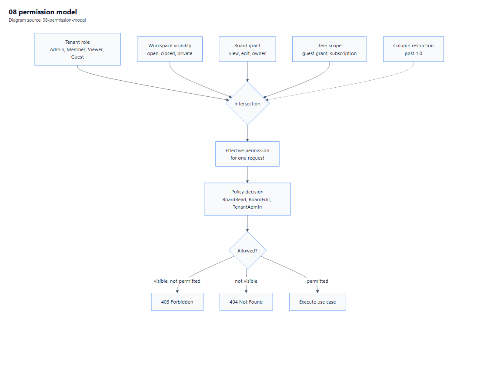

# 05 — Security and Compliance

**Purpose.** Authentication, authorisation, tenant isolation, audit, the OWASP-relevant control set, secrets management, and the intellectual-property guardrails that make this build defensible.

**Depends on:** [02-Architecture.md](02-Architecture.md) §5 · **Related:** [11-Clean-Room-Protocol.md](11-Clean-Room-Protocol.md), [08](08-Deployment-and-Operations.md) · **Index:** [00-Contents.md](00-Contents.md)

**Diagram:** [Permission model](Diagrams/08-permission-model.pdf)

---

## 1. Threat model, in one page

| Asset | Adversary | Primary control |
|---|---|---|
| One tenant's board data | Authenticated user of another tenant | Tenant discriminator + fail-closed filter + adversarial test suite |
| Guest-visible data | Guest attempting to widen scope | Per-board grants, no workspace visibility [S5] |
| API tokens | Leaked credential in a repository | Hash-only storage, prefix search, scopes, expiry, revocation |
| Session | Stolen cookie | `HttpOnly`, `Secure`, `SameSite=Lax`, rotation, security-stamp invalidation |
| Webhook payloads | Forgery / replay to a customer endpoint | HMAC signature + timestamp + challenge verification [S12] |
| Audit trail | Insider covering tracks | Append-only, hash-chained, no update/delete grants |
| Attachments | Unauthorised download by URL guess | Opaque storage keys, short-lived signed URLs, tenant prefix |
| Automation engine | Malicious recipe causing resource exhaustion | Loop depth cap, per-tenant action quota [S1], execution timeout |

Not in the threat model: a compromised host. If an attacker has root on the app server, they have the database credentials and the Data Protection keys. On-prem security is therefore also a *hardening* problem, addressed in [08](08-Deployment-and-Operations.md) §5.

---

## 2. Authentication controls

| Control | Requirement | Rationale |
|---|---|---|
| OIDC authorization code + PKCE | **MUST** for all interactive clients | No implicit flow, ever |
| Cookie session for Blazor | **MUST** | `HttpOnly`, `Secure`, `SameSite=Lax`, 8-hour sliding |
| Password storage | ASP.NET Core Identity hasher (PBKDF2, current defaults) | Never a custom hash |
| Password length | ≥ 12, no composition rules, breach-list rejection | Current NIST guidance; composition rules produce `Password1!` |
| MFA | TOTP; enforceable per tenant; **required** for `TenantAdmin` | Admin compromise is total compromise |
| Account lockout | Exponential backoff after 5 failures, per account and per IP | Slows credential stuffing without enabling a DoS on a known username |
| Session revocation | Security stamp checked on each circuit heartbeat and each API call | Role changes must take effect, not wait for expiry |
| PAT format | `tue_pat_` + 32 random bytes, base32; stored as SHA-256 | Prefix allows lookup without storing plaintext |
| PAT expiry | Default 90 days, maximum 365 | Limits blast radius of a leak |
| Service accounts | OAuth client credentials, scoped, no interactive login | Separate lifecycle from humans |

### 2.1 The Blazor-specific session problem

A Blazor Server circuit can live for hours. If a user is demoted or removed, a naive implementation keeps serving them until the tab closes. Controls:

1. `SecurityStamp` is included in the circuit's authentication state.
2. A scoped `CircuitSecurityService` re-validates the stamp every 60 seconds.
3. On mismatch, the circuit is force-closed and the client is redirected to sign-in with a reason.

This is a real requirement, not a nicety — the alternative is an authorisation bypass with a friendly UI.

---

## 3. Authorisation

### 3.1 Model

Resource-based policies, resolved from a per-request permission snapshot ([02](02-Architecture.md) §5.2). Four inputs intersect: tenant role, workspace visibility, board grant, item scope.

*Vector: [08-permission-model.pdf](Diagrams/08-permission-model.pdf) · source: [08-permission-model.mmd](Diagrams/08-permission-model.mmd)*

### 3.2 Capability matrix

| Capability | Admin | Member | Viewer | Guest |
|---|---|---|---|---|
| Manage tenant settings, users, security | ✅ | ❌ | ❌ | ❌ |
| Create / delete boards | ✅ | ✅ | ❌ [S5] | ❌ |
| Edit items and column values | ✅ | ✅ | ❌ [S5] | On granted board only |
| Add updates / like | ✅ | ✅ | ❌ [S5] | On granted board only |
| View main boards | ✅ | ✅ | ✅ | ❌ [S9] |
| View granted shareable/private board | ✅ | If granted | If granted | Only if granted [S9] |
| Use the public API | ✅ | ✅ | **❌** [S5] | ❌ |
| Create API tokens | ✅ | ✅ | ❌ | ❌ |
| Be a board owner | ✅ | ✅ | ❌ [S5] | ❌ |
| Invite viewers | ✅ | ✅ | ✅ (unless restricted) [S5] | ❌ |

Every ❌ in this table is a test case. The viewer row is the one most likely to be implemented wrongly, because "read-only user" sounds harmless and the API denial is easy to forget.

### 3.3 Enforcement points

| Layer | Enforces | Bypass risk |
|---|---|---|
| Endpoint / page | Coarse policy (`BoardRead`, `BoardEdit`) | Low |
| Application use case | Resource policy with the snapshot | Medium if a new use case forgets to declare |
| Query layer | Tenant filter + board scope predicates | **Highest** — `IgnoreQueryFilters()` |
| Database | Grants only (app role has full DML on its schema) | n/a |

Mitigations: a use-case base class that **requires** a policy declaration (compile-time enforcement), a static-analysis rule banning `IgnoreQueryFilters` outside the tenancy module, and the isolation test suite (§4).

---

## 4. Tenant isolation

### 4.1 Controls

1. `TenantId` on every tenant-scoped table, leading every composite index.
2. EF Core global query filter, fail-closed when no tenant is resolved.
3. `SaveChanges` interceptor that rejects a mismatched tenant on insert and update.
4. Tenant resolved **only** from the authenticated principal's membership claim.
5. Attachment storage keys prefixed with the tenant id; signed URLs bound to tenant and user.

### 4.2 The isolation test suite

This is the control that actually proves the property. It runs on every build, not nightly.

| Test | Method |
|---|---|
| Cross-tenant read via API | Authenticate as tenant A, request tenant B's board id, assert **404** (not 403) |
| Cross-tenant read via UI route | Navigate to tenant B's board URL as tenant A, assert redirect/404 and no data in the response body |
| Cross-tenant write | Attempt a value update on a foreign item, assert 404 and no row mutation |
| Cross-tenant search | Search a term that exists only in tenant B, assert zero results |
| Cross-tenant attachment | Request a signed URL minted for tenant B, assert rejection |
| Filter bypass audit | Static analysis: no `IgnoreQueryFilters` outside the tenancy module |
| Guest escalation | Guest attempts a workspace listing, a board they were not granted, and an API call; all denied |
| Viewer API denial | Viewer's token cannot be issued; a previously issued token is rejected after demotion [S5] |

The 404-not-403 rule is deliberate: existence is information. This is asserted explicitly because returning 403 "feels" more correct and is a leak.

---

## 5. OWASP Top 10 mapping

| Risk | Control in this design | Verification |
|---|---|---|
| **A01 Broken access control** | Resource policies + snapshot + isolation suite | §4.2, plus per-capability tests from §3.2 |
| **A02 Cryptographic failures** | TLS 1.2+ only, HSTS, no secrets in logs, PBKDF2 hashes, HMAC webhook signatures | Config review + log scan test |
| **A03 Injection** | Parameterised EF/Dapper only; no string-concatenated SQL; HTML sanitised on write | Static analysis + a corpus of injection payloads in tests |
| **A04 Insecure design** | Threat model (§1), quota enforcement, loop caps | Design review gate |
| **A05 Security misconfiguration** | Hardened defaults, no debug in production, explicit CORS allow-list, security headers | Config test asserts headers present |
| **A06 Vulnerable components** | Pinned versions, licence review, dependency audit in CI [S19] | Build gate |
| **A07 Auth failures** | OIDC + PKCE, lockout, MFA, security stamp | §2 tests |
| **A08 Integrity failures** | Signed releases, pinned base images, audit hash chain | Release checklist |
| **A09 Logging failures** | Structured logs with correlation id, audit trail, alerting on auth anomalies | Trace assertion (NFR-11) |
| **A10 SSRF** | Webhook URLs validated: https only, no loopback/link-local/private ranges, DNS re-resolution at delivery | URL validation tests |

A10 deserves emphasis: an outbound webhook feature is an SSRF engine by default. The allow/deny logic must reject `169.254.169.254`, `127.0.0.1`, `::1`, RFC1918 ranges, and any hostname that resolves into them — and must re-resolve at delivery time, because DNS can change between registration and send.

### 5.1 Security headers

`Content-Security-Policy` (no `unsafe-inline` for scripts; hashes or nonces for the few inline needs), `X-Content-Type-Options: nosniff`, `Referrer-Policy: strict-origin-when-cross-origin`, `Permissions-Policy` denying camera/microphone/geolocation, `Strict-Transport-Security` with a one-year max-age once TLS is confirmed.

CSP and Blazor interact badly by default because of inline boot scripts. The plan is to use nonces, and to test the CSP in report-only mode for a week before enforcing — a CSP that breaks the board is worse than no CSP at all.

---

## 6. Audit logging

| Property | Requirement |
|---|---|
| Coverage | Every mutation: create, update, delete, permission change, login, token issue/revoke, export |
| Content | Actor, tenant, action, target type/id, before/after JSON, correlation id, timestamp (UTC) |
| Integrity | `Hash = SHA256(PrevHash ‖ canonical(payload))` — a broken chain is detectable |
| Mutability | Append-only. The application's DB user has `INSERT` and `SELECT` on the audit table, no `UPDATE`/`DELETE` |
| Separation | Audit writes happen in the same transaction as the change, so a rolled-back change leaves no false record |
| Retention | 24 months hot, then archive (Q5) |
| Access | `TenantAdmin` can read their own tenant's audit; platform operators read via a separate break-glass path that is itself audited |

Hash chaining does not make tampering impossible — a determined operator with database access can recompute the chain. It makes tampering *detectable*, which is the honest claim, and the manuals say so rather than implying immutability.

---

## 7. Secrets and cryptography

| Secret | Storage (Docker) | Storage (IIS) | Rotation |
|---|---|---|---|
| MySQL connection string | Docker secret / env from `.env` outside the image | `appsettings.Production.json` with DPAPI-encrypted section, or environment | 90 days |
| OpenIddict signing certificate | Mounted PFX, read-only | `cert:\LocalMachine\My` with ACL | Annual, with overlap |
| Data Protection key ring | Redis + mounted volume | Shared folder with ACL | Automatic |
| Webhook signing secrets | Per-subscription row, encrypted at rest | Same | Per subscription, on rotation request |
| SMTP credentials | Docker secret | Environment | 180 days |
| Redis password | Docker secret | Environment | 90 days |

Rules:

- **No secret in an image layer.** Ever. A secret in a Dockerfile is a secret in every registry copy.
- **No secret in a log.** A structured-logging enricher redacts known key names; a test asserts no connection string appears in captured logs.
- **Encryption at rest** is the operator's responsibility: MySQL tablespace encryption or volume encryption. The application does not double-encrypt column values — that would break search and sorting for no real gain on an on-prem host the operator already controls.
- **TLS** terminates at the proxy; the app trusts forwarded headers only from configured proxy addresses, never from arbitrary clients.

### 7.1 Data Protection keys are a security control, not a detail

Blazor Server and antiforgery both depend on the Data Protection key ring. If two instances generate different keys:

- Users are randomly signed out when a request lands on the wrong node.
- Antiforgery tokens fail, producing "400 bad request" on form posts.
- Auth cookies fail to decrypt.

The key ring must be shared (Redis or a common volume) **before** the second instance is added. This is a deployment gate, not a tuning step, and it is checked in [10](10-Acceptance-Checklists.md) under P6.

---

## 8. Intellectual property and clean-room guardrails

Full protocol: [11-Clean-Room-Protocol.md](11-Clean-Room-Protocol.md). The security-relevant summary:

| Rule | Enforcement |
|---|---|
| No monday.com source, decompiled binaries, or copied files in the repository | Pre-commit and CI scan for their domains, asset hashes and known filenames |
| No their-trademark use in code, UI, docs or metadata | A banned-string list checked in CI (`monday`, their product names, their logo file names) |
| No scraping of protected assets (CSS, images, fonts) | Research log records only textual documentation and public marketing pages |
| No import of their data-export format | Deliberately out of scope ([01](01-Requirements.md) §5) — importing their schema invites copying it |
| Every requirement traceable to a public source | The traceability tags in [01](01-Requirements.md) §8 and the register in [13](13-Source-Register.md) |

The last row is the strongest defence available: if every behaviour can be pointed at a public document, the claim "we derived this from public documentation" is demonstrable rather than asserted.

---

## 9. Licence compliance register

Verified against NuGet on 3 Nov 2026 [S19]. This register must be re-run at every release.

| Component | Licence | Obligation | Status |
|---|---|---|---|
| .NET 10, ASP.NET Core, EF Core 10 | MIT | Attribution | ✅ |
| MudBlazor 9.12.0 | MIT | Attribution | ✅ |
| OpenIddict 7.7.2 | Apache-2.0 | Attribution, NOTICE | ✅ |
| FluentValidation 12.2.0 | Apache-2.0 | Attribution | ✅ |
| Mapperly 4.3.1 | Apache-2.0 | Attribution | ✅ |
| Quartz.NET 4.7.0 | Apache-2.0 | Attribution | ✅ |
| Polly 8.9.0 | BSD-3-Clause | Attribution, no endorsement | ✅ |
| MySqlConnector 2.6.2 | MIT | Attribution | ✅ |
| **Npgsql.EntityFrameworkCore.PostgreSQL 10.0.0** | **MIT** | PostgreSQL provider; system of record | ✅ **No action** |
| MySql.EntityFrameworkCore 10.0.12 (Oracle) *(superseded)* | **GPLv2 + FOSS exception** | Replaced by PostgreSQL | ✅ **Retired** |
| MediatR 14 / AutoMapper 16 / MassTransit 9 | RPL-1.5 / commercial | — | ❌ Not used [S21][S23] |
| Hangfire | LGPL-3.0 | Relink obligation | ❌ Not used [S22] |
| Duende.IdentityServer | Commercial | — | ❌ Not used [S24] |
| FluentAssertions 8 | Commercial (Xceed) | — | ❌ Not used |
| dhtmlx-gantt | GPL / commercial | — | ❌ Not used (own Gantt) |

Two entries carry real consequences. The Oracle provider is the only ⚠️ and is the direct cost of D2. The Gantt decision in [04](04-UI-and-UX-Plan.md) §5 exists specifically to keep a GPL/commercial chart library out of the core view.

---

## 10. Secure development lifecycle

| Stage | Control |
|---|---|
| Design | Threat model per feature touching auth, tenancy, files or outbound HTTP |
| Code | Banned-API analysers (raw SQL, `IgnoreQueryFilters`, `Html.Raw` on user content), nullable enabled, warnings as errors |
| Review | Every PR touching authorisation requires a second reviewer with security context |
| Build | Dependency audit, secret scan, licence scan, SBOM generation |
| Test | Isolation suite mandatory; authorisation matrix tests mandatory |
| Release | Signed artefacts, pinned base image digests, release checklist in [10](10-Acceptance-Checklists.md) |
| Operate | Failed-login alerting, audit anomaly review, quarterly access review |

### 10.1 Incident response (minimum viable)

1. **Detect** — alert on failed-login spikes, audit-chain gaps, quota anomalies.
2. **Contain** — revoke tokens and sessions tenant-wide (a single command path must exist for this); disable an API client.
3. **Preserve** — snapshot audit table and logs before any remediation.
4. **Notify** — operator-defined; the product provides the affected-tenant list and the timeline.
5. **Remediate and review** — post-incident note, and a regression test for the specific failure.

The "revoke everything for a tenant" path is called out because it is the one operation nobody builds until the day they need it at 3 a.m.

---

## 11. What this manual does not claim

- It does not claim certification against any standard (SOC 2, ISO 27001). Those are organisational programmes, not documentation deliverables.
- It does not claim the audit trail is immutable, only tamper-evident (§6).
- It does not claim MySQL encryption at rest is configured — that is an operator task documented in [08](08-Deployment-and-Operations.md) §5.4.
- It does not claim the SSRF deny-list is exhaustive; it claims it is tested against the standard vectors and re-resolved at delivery.

---

**Next:** [06-Integrations-and-Extensibility.md](06-Integrations-and-Extensibility.md).
