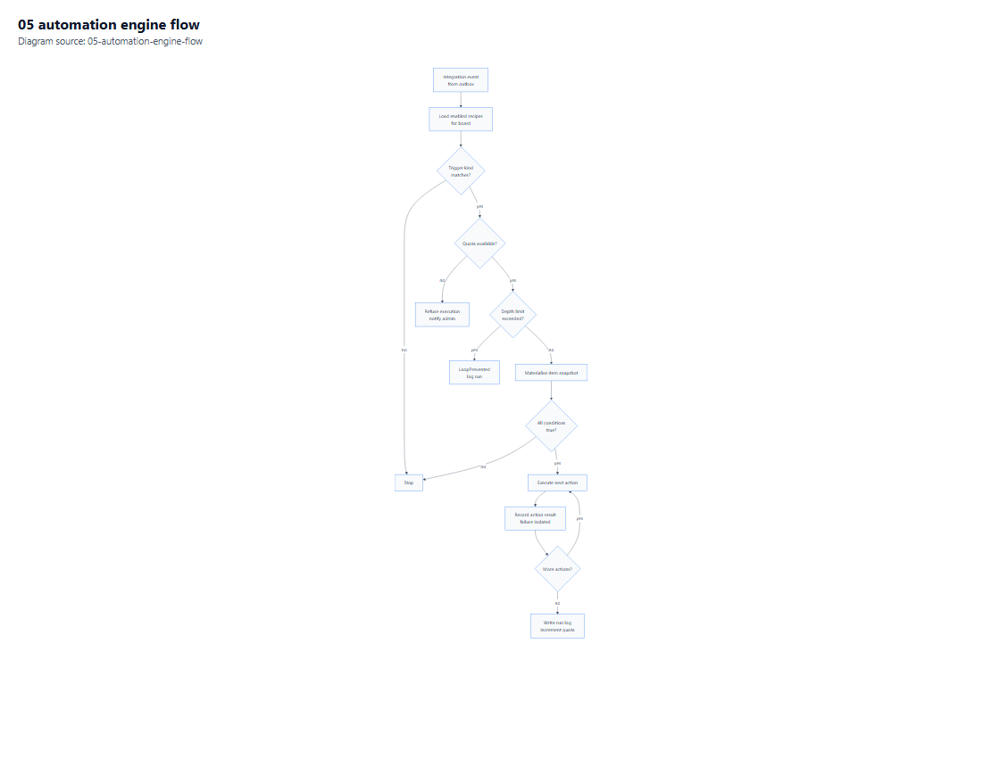

# 06 — Integrations and Extensibility

**Purpose.** The automation DSL, outbound webhooks, the public API contract, inbound integrations, and the plugin contract that replaces a marketplace.

**Depends on:** [02-Architecture.md](02-Architecture.md) §7, §9 · **Related:** [01](01-Requirements.md) §3.4, [05](05-Security-and-Compliance.md) §5 (SSRF) · **Index:** [00-Contents.md](00-Contents.md)

**Diagram:** [Automation engine flow](Diagrams/05-automation-engine-flow.pdf)

---

## 1. Scope position

**Decision D5.** Core recipes, multi-action, scheduled triggers, outbound webhooks, a public REST API, and a documented plugin contract. **No marketplace.**

| In scope | Out of scope |
|---|---|
| Recipe builder over a fixed trigger/action vocabulary | Third-party apps listed for install |
| Multi-action chains [S6] | App review pipeline, revenue share |
| Scheduled and date-arrival triggers [S6] | Sandboxed third-party code execution |
| Outbound webhooks with handshake [S12] | Inbound app OAuth consent screens for public apps |
| REST API with quotas and idempotency [S11][S25] | GraphQL endpoint (Q2) |
| In-process plugin contract for operators | Plugin distribution, signing, store |

The plugin contract exists so an operator can add a connector without forking the product. It is loaded from a local directory, runs in-process, and is explicitly **not** a security boundary — see §6.3.

---

## 2. The automation DSL

*Vector: [05-automation-engine-flow.pdf](Diagrams/05-automation-engine-flow.pdf) · source: [05-automation-engine-flow.mmd](Diagrams/05-automation-engine-flow.mmd)*

### 2.1 Recipe shape

A recipe is three JSON documents stored on the `Automation` row ([03](03-Data-Model.md) §3.5): `TriggerJson`, `ConditionsJson`, `ActionsJson`. This mirrors the documented trigger → condition → action model [S6] without copying any particular serialisation.

| Part | Cardinality | Semantics |
|---|---|---|
| Trigger | exactly 1 | The event that starts evaluation [S6] |
| Conditions | 0..n, AND-joined | Must all hold before any action runs [S6] |
| Actions | 1..n, ordered | Executed serially; one failure does not abort the rest [S6] |

### 2.2 Trigger vocabulary

| Kind | Fires when | Arguments |
|---|---|---|
| `item_created` | An item is created on the board | none |
| `item_deleted` | An item is deleted or archived | none |
| `status_changed` | A status column's label changes | `columnId`, optional `toLabelId` |
| `column_changed` | Any column value changes | `columnId` |
| `date_arrived` | A date column's value is reached | `columnId`, `offsetDays` |
| `person_assigned` | A people column gains a person | `columnId` |
| `recurring` | A schedule fires | `cron`, `timezone` |
| `button_clicked` | A `button` column is pressed | `columnId` |
| `webhook_received` | An inbound signed call targets a recipe | `secretRef` |

`date_arrived` and `recurring` are the two that require the scheduler ([02](02-Architecture.md) §7.3). `webhook_received` is the one that turns a recipe into an inbound integration point, and it is gated behind a per-recipe secret.

### 2.3 Condition operators

| Operator | Applies to | Notes |
|---|---|---|
| `equals` / `not_equals` | text, status, dropdown, number, date, person | Status compares by label id, not display text |
| `contains` / `starts_with` | text, long_text | Case-insensitive, collation-aware |
| `greater_than` / `less_than` | number, date, rating | Half-open range semantics |
| `is_empty` / `is_not_empty` | all | Empty means no value row, not an empty string |
| `any_of` / `none_of` | status, dropdown, people, tags | Set membership |
| `between` | number, date | Inclusive start, inclusive end for dates |

Conditions are evaluated against a **materialised item snapshot** loaded once per execution. Evaluating them lazily against the database would produce N queries per recipe and inconsistent results if the item changes mid-evaluation.

### 2.4 Action vocabulary

| Kind | Parameters | Effect |
|---|---|---|
| `set_column_value` | `columnId`, `value` | Writes through the same value writer as the UI |
| `create_item` | `groupId`, `name`, `values` | Creates an item; supports variable substitution from the trigger item |
| `create_subitem` | `parentItemId`, `name`, `values` | Supports parent-value prefill at creation only [S8] |
| `move_item_to_group` | `groupId` | Reorders with a new position key |
| `archive_item` | — | Soft delete |
| `assign_person` | `columnId`, `personId` | People column write |
| `notify_user` | `userIds`, `message` | In-app notification [S6] |
| `send_email` | `to`, `template`, `variables` | SMTP [A7] |
| `call_webhook` | `url`, `payload` | Signed outbound POST |
| `duplicate_item` | `targetBoardId` | Copy with values |

**Variable substitution** is a restricted template syntax (`{{item.name}}`, `{{column.<id>.text}}`), evaluated server-side against the snapshot. No expression evaluator, no `eval`, no functions beyond a fixed set — an automation product with a Turing-complete expression language is an unbounded security and support surface.

### 2.5 Execution semantics

| Property | Value | Reason |
|---|---|---|
| Ordering | Recipes ordered by `Importance`, then creation time [S6] | Deterministic when several match |
| Action order | Serial, in the stored order [S6] | Matches user expectation of "then do this, then do that" |
| Failure | Recorded per action; subsequent actions still attempt | A dead webhook must not block a status update |
| Retry | Only for `call_webhook` and `send_email`; 3 attempts, exponential backoff | Value writes are not retried — they are deterministic and a retry could double-apply |
| Timeout | 30 s per recipe execution | Prevents a slow endpoint from pinning a worker |
| Loop guard | Depth ≤ 3, correlation id tracked | §2.6 |
| Quota | Action counted before execution, per tenant per month [S1] | Matches the documented metered model |

### 2.6 Loop and cascade safety

The failure mode everyone hits first: a recipe sets a status; that triggers a second recipe that sets the same status back. Tuesday.com applies:

1. A **depth counter** on the correlation chain; beyond 3, execution stops and an `AutomationRun` row records `LoopPrevented`.
2. **Value-change suppression** — an action that writes a value identical to the current one produces no domain event, so it cannot re-trigger.
3. A **per-board execution budget** per minute; exceeding it suspends the board's automations and notifies the admin, rather than degrading the whole deployment.

### 2.7 Worked example (described, not coded)

"When status becomes Done, notify the item's owner and create a follow-up subitem":

- Trigger: `status_changed`, column `Status`, `toLabelId` = Done.
- Conditions: `is_not_empty` on `People`, so items without an owner are skipped.
- Actions: `notify_user` with `{{column.people.ids}}`; `create_subitem` named "Follow-up: {{item.name}}" with the parent's due date prefilled at creation [S8].

This example is used as the P5 acceptance scenario because it exercises a trigger, a condition, variable substitution, a notification, and a child-board write in one recipe.

---

## 3. Outbound webhooks

### 3.1 Registration and handshake

Registration is a two-step exchange, mirroring the documented challenge model [S12]:

1. Subscriber posts a URL and event list.
2. The platform sends a JSON POST containing a random `challenge` value.
3. The subscriber must echo that exact value back in a JSON body.
4. Only then is `VerifiedAt` set and delivery enabled [S12].

A subscription that never completes the handshake is stored but inactive, and the UI says why. Silent failure here is a support ticket waiting to happen.

### 3.2 Delivery contract

| Property | Value |
|---|---|
| Method | `POST`, `application/json` |
| Signature | `X-Tue-Signature: t=<unix>,v1=<hex HMAC-SHA256(t + "." + body)>` |
| Replay window | 5 minutes; older timestamps rejected |
| Retries | 5 attempts over ~30 minutes, exponential with jitter, on 5xx/timeout only |
| Success | 2xx within 10 s |
| Ordering | Not guaranteed; `eventId` allows subscriber-side dedupe |
| Disable | After 20 consecutive failures, subscription auto-disabled and the owner notified |
| Payload | `{ eventId, type, occurredAt, tenantId, boardId, itemId?, changed: {...} }` |

`changed` carries only changed column ids and their new projections — not the whole item. Subscribers that need the full item call the API.

### 3.3 Why HMAC with a timestamp

A signature over the body alone allows replay. A timestamp alone allows tampering. Both together, with a 5-minute window, gives integrity and freshness. The header format is deliberately Stripe-like because it is the pattern integrators already know how to verify.

### 3.4 SSRF and egress controls

Reuses the deny-list from [05](05-Security-and-Compliance.md) §5 (A10): https only, no loopback, link-local, private ranges, or metadata endpoints; DNS re-resolved at delivery. On-prem, an operator may additionally restrict egress at the firewall — documented in [08](08-Deployment-and-Operations.md) §4.6.

---

## 4. Public API

### 4.1 Surface

| Resource | Operations | Notes |
|---|---|---|
| `/api/v1/workspaces` | list, get | Scoped to the caller's visibility |
| `/api/v1/boards` | list, get, create, update, archive | Board type respected on create [S9] |
| `/api/v1/boards/{id}/groups` | list, create, update, delete | |
| `/api/v1/boards/{id}/columns` | list, create, update | 500-column cap enforced [S3] |
| `/api/v1/boards/{id}/items` | list (cursor), create, update, delete | Bulk create up to 100 |
| `/api/v1/items/{id}` | get, update | Includes subitems on request |
| `/api/v1/items/{id}/values` | list, patch | Max 50 columns per patch |
| `/api/v1/items/{id}/updates` | list, create | |
| `/api/v1/users` | list, get | Tenant-scoped |
| `/api/v1/webhooks` | list, create, delete | Triggers handshake [S12] |
| `/api/v1/search` | query | Permission-filtered [S11]-style cost |

### 4.2 Contract rules

| Rule | Detail |
|---|---|
| Versioning | `/api/v1` path; additive changes only within a version; a breaking change opens `v2` and `v1` stays for ≥6 months [S26] |
| Pagination | Cursor only; `limit` max 500, default 50 |
| Errors | problem+json with stable `code` and `retry_in_seconds` when throttled [S11] |
| Idempotency | `Idempotency-Key` on all POST/PATCH; 30-minute window; replay header; 409 on concurrent duplicate [S25] |
| Auth | Bearer JWT or PAT; `Viewer` role issues no usable token [S5] |
| Quotas | Daily calls per token, per-minute sliding budget, per-request cost ceiling [S11] |
| Rate-limit errors | Always include `retry_in_seconds` [S11] |
| Deprecation | `Sunset` and `Deprecation` headers, 90 days' notice minimum |

### 4.3 Cost accounting

Each request computes cost from rows touched and relation depth, capped per request. The numbers chosen for the ceiling follow the documented magnitude (5M per single query) [S11] so that operator intuition transfers, without claiming arithmetic equivalence.

---

## 5. Inbound integrations

| Connector | Mechanism | Phase |
|---|---|---|
| SMTP email | Outbound only; operator-configured [A7] | P4 |
| Generic inbound webhook | `webhook_received` trigger with per-recipe secret | P5 |
| Slack-compatible webhook | `call_webhook` with a Slack-shaped payload | P5 |
| Calendar feed | Read-only ICS export per user, token-authenticated | P6 |
| CSV import | Board-shaped import with column mapping | P6 |
| CSV export | Current view, respecting filters | P2 |
| OIDC federation | Enterprise SSO login | P6 stretch |

CSV import is included and monday.com export import is not ([01](01-Requirements.md) §5). That asymmetry is intentional and legal, not technical: consuming their export format means consuming their schema and their users' content shape.

---

## 6. Plugin contract

### 6.1 What a plugin can contribute

| Extension point | Contract |
|---|---|
| `ITriggerHandler` | Declares a trigger kind, validates arguments, emits events |
| `IActionHandler` | Declares an action kind, validates parameters, executes against an item context |
| `IConnector` | Named outbound transport (e.g. a bespoke chat service) |
| `IColumnRenderer` | Client-side renderer for a custom column type (advanced) |

### 6.2 Loading

- Assemblies are read from a configured directory at startup; no hot-reload in production.
- Each plugin declares an id, version, and the host version range it supports.
- A plugin that fails to load is logged and skipped — it must not prevent the host from starting.
- Plugins are disabled by default; an operator enables each by id in configuration.

### 6.3 What a plugin is not

**A plugin is not a sandbox.** It runs in-process with the application's database credentials and can read anything the app can read. This is stated in the plugin documentation in those words, because the alternative — a false implication of isolation — is worse than the limitation.

Consequences:

1. Only operators install plugins; end users cannot.
2. There is no marketplace, no review, no signature requirement (D5).
3. A per-tenant plugin toggle would create a false security boundary and is therefore not offered.

If third-party code execution is ever required, it needs a separate process boundary and a capability model — an XXL change recorded in [09](09-Risks-and-Open-Questions.md) §3.6.

---

## 7. Integration testing expectations

| Test | Asserts |
|---|---|
| Handshake | Unverified subscription never receives a payload [S12] |
| Signature | A tampered body is rejected; an old timestamp is rejected |
| Retry | A 500 endpoint is retried 5× and then the subscription degrades |
| Idempotency | Same key twice returns the cached response, one side effect [S25] |
| Quota | The 1,001st call in a day on a Standard-tier tenant is refused with `retry_in_seconds` [S11] |
| Loop guard | A self-triggering recipe stops at depth 3 and logs `LoopPrevented` |
| Action isolation | A failing `call_webhook` does not prevent the following `notify_user` |
| SSRF | Registration of a loopback or metadata URL is refused |

These are the tests that separate "we built automations" from "automations work under load and abuse".

---

**Next:** [07-Testing-Strategy.md](07-Testing-Strategy.md).
