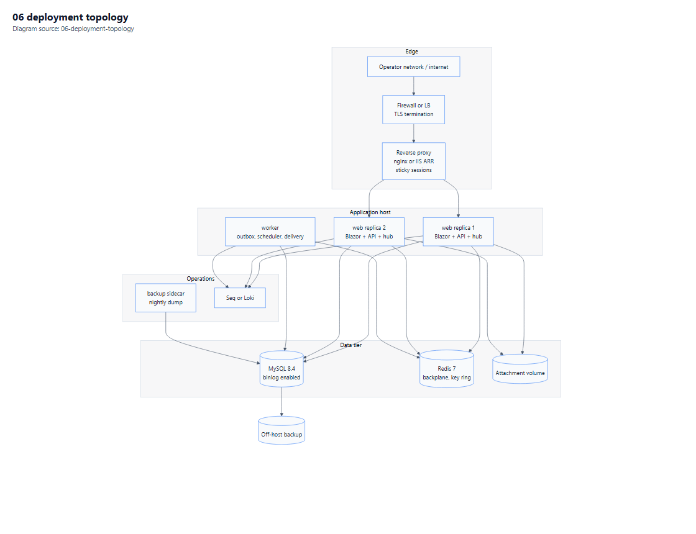

# 08 — Deployment and Operations

**Purpose.** How Tuesday.com is packaged, deployed, observed, backed up, recovered and upgraded on operator-owned infrastructure.

**Depends on:** [02-Architecture.md](02-Architecture.md), [05](05-Security-and-Compliance.md) §7 · **Related:** [10-Acceptance-Checklists.md](10-Acceptance-Checklists.md) · **Index:** [00-Contents.md](00-Contents.md)

**Diagram:** [Deployment topology](Diagrams/06-deployment-topology.pdf)

---

## 1. Deployment profile

| Property | Value |
|---|---|
| Application type | ASP.NET Core 10 web app (Blazor Web App) + worker process |
| Packaging | OCI container image, plus a Windows Server deployment path |
| Target OS | Linux containers (primary); Windows Server 2022+ (secondary) |
| Runtime | Framework-dependent on the .NET 10 ASP.NET Core runtime image |
| Primary orchestrator | Docker Compose v2 |
| Secondary | IIS 10 + ASP.NET Core Module (ANCM) [S18] |
| Database | MySQL 8.4, operator-managed [A10] |
| Cache/backplane | Redis 7 |
| Object storage | Filesystem volume or S3-compatible endpoint [A6] |
| TLS | Terminated at the reverse proxy |
| Scale unit | Stateless web replicas + single-worker (or clustered) job runner |

Two supported topologies exist because on-prem operators differ: some have a Linux VM and want Compose, others have a Windows Server with IIS and no container runtime. Supporting both is a real cost, paid in §5.

---

## 2. Topology

*Vector: [06-deployment-topology.pdf](Diagrams/06-deployment-topology.pdf) · source: [06-deployment-topology.mmd](Diagrams/06-deployment-topology.mmd)*

### 2.1 Services (Compose)

| Service | Image | Replicas | Purpose |
|---|---|---|---|
| `proxy` | nginx (pinned digest) | 1 | TLS, static caching, WebSocket upgrade, sticky routing |
| `web` | `tuesday-web:<version>` | 2 | UI, REST API, SignalR hub |
| `worker` | `tuesday-worker:<version>` | 1 | Outbox relay, automation dispatcher, scheduler, webhook delivery |
| `mysql` | `mysql:8.4` | 1 | System of record |
| `redis` | `redis:7` | 1 | Backplane, cache, Data Protection ring |
| `logs` | Seq or Loki | 1 | Structured log aggregation |
| `backup` | `mysql:8.4` + cron sidecar | 1 | Nightly dump, binlog retention |

`web` and `worker` share an image and differ by entry point. One artefact, one version, one migration owner.

### 2.2 Why the worker is separate

Scheduled jobs and webhook retries must not compete with interactive requests for thread pool and memory. A long webhook retry storm inside the web process degrades board rendering, which is the one thing users notice. The worker also holds the Quartz cluster lock ([02](02-Architecture.md) §7.3), so exactly one instance fires each schedule.

### 2.3 Sticky sessions and the backplane

Even with the Redis backplane, SignalR requires that all HTTP requests for a given connection reach the same server process [S17]. With two `web` replicas behind nginx:

- `ip_hash` or a cookie-based affinity rule is required.
- WebSocket upgrade must be proxied with `Upgrade` and `Connection` headers preserved.
- Read timeouts must be raised; the default 60 s proxy read timeout kills idle circuits.

**Both the backplane and affinity are required.** Deploying only one is the most common production failure for Blazor Server + SignalR, and it presents as random disconnects that look like a bug in the app.

---

## 3. Configuration

| Source | Precedence | Contents |
|---|---|---|
| `appsettings.json` | Lowest | Non-secret defaults |
| `appsettings.{Environment}.json` | Middle | Environment tuning |
| Environment variables | High | Connection strings, endpoints, feature flags |
| Docker secrets / mounted files | Highest | Passwords, certificates, SMTP credentials |

| Setting | Example shape | Notes |
|---|---|---|
| `ConnectionStrings:Default` | `Server=mysql;Database=tuesday;Uid=…;SslMode=Required` | Never in the image |
| `Redis:Configuration` | `redis:6379,password=…` | Backplane + cache |
| `Storage:Root` | `/var/tuesday/files` or an S3 endpoint | [A6] |
| `Smtp:Host/Port/From` | operator-provided | [A7] |
| `Auth:Authority` | public URL of the app's own OIDC issuer | Must match externally reachable URL |
| `ForwardedHeaders:KnownProxies` | proxy addresses | Required for correct redirect URIs |

`Auth:Authority` mismatches are the single most common first-deploy failure: OpenIddict issues tokens for the URL it thinks it is, and a mismatch produces a redirect loop that looks like a broken login page.

---

## 4. Docker Compose deployment

### 4.1 Prerequisites

| Item | Requirement |
|---|---|
| Docker Engine / Compose | 24+ / v2 |
| Host resources | 4 vCPU, 16 GB RAM, 200 GB SSD (small deployment) |
| TLS certificate | PEM + key, mounted read-only |
| DNS | A record for the chosen hostname |
| MySQL data volume | Dedicated volume with backup snapshots |

### 4.2 First deploy sequence (to be run by an implementer later)

1. Create `.env` from the template; fill secrets; set file permissions to owner-only.
2. Bring up `mysql` and `redis`; wait for healthy.
3. Run the idempotent migration script (not the runtime migrator — [03](03-Data-Model.md) §9.3).
4. Bring up `web` and `worker`.
5. Verify `/health/live` and `/health/ready` from the proxy.
6. Sign in as the seeded admin; rotate the seeded password immediately.
7. Configure SMTP and confirm a test email.
8. Complete the P6 checklist in [10](10-Acceptance-Checklists.md).

### 4.3 Compose-level controls

| Control | Setting |
|---|---|
| Restart policy | `unless-stopped` for all long-running services |
| Healthchecks | `web`: HTTP probe; `mysql`: `mysqladmin ping`; `redis`: `redis-cli ping` |
| Resource limits | `web` 2 GB memory, `worker` 1 GB, `mysql` 4 GB (tuned per host) |
| Logging driver | `json-file` with `max-size` and `max-file` to prevent disk exhaustion |
| Read-only root | `web` and `worker` with writable tmpfs only |
| User | Non-root `app` user in both images |

Disk exhaustion from unbounded container logs is a classic on-prem outage. The logging driver limits are not optional.

---

## 5. Windows Server + IIS deployment

ANCM hosts the app out-of-process from `w3wp.exe` [S18]. Requirements that are easy to miss:

| Requirement | Why |
|---|---|
| **WebSocket Protocol** Windows feature installed | Without it, SignalR silently falls back to long polling and burns threads |
| **Application Request Routing (ARR)** with client affinity | Same affinity requirement as nginx [S17] |
| App pool identity granted read on the content root and write on the Data Protection folder | Key ring write failure breaks auth |
| `ASPNETCORE_ENVIRONMENT=Production` set at the app pool level | Otherwise developer exception pages leak |
| `web.config` with `hostingModel="outofprocess"` | Avoids in-process recycling surprises during upgrades |
| Request timeout raised on ARR | Idle circuits otherwise drop |
| HTTPS binding with a valid certificate, HTTP redirected | Redirect must be to the external hostname, matching `Auth:Authority` |

### 5.1 IIS vs Compose

| Concern | Compose | IIS |
|---|---|---|
| Multi-instance affinity | nginx `ip_hash`/cookie | ARR client affinity |
| TLS | nginx | IIS binding |
| Key ring sharing | Redis / volume | Shared folder with ACL |
| Upgrade | `docker compose pull && up -d` | App Offline file + deploy |
| Rollback | Re-tag and recreate | Swap back the previous folder |

Both paths need the same three things: shared Data Protection keys, sticky sessions, and WebSocket support. Those three are the checklist, and they are identical for both hosts.

---

## 6. Operational concerns that bite in production

### 6.1 Data Protection key ring

Shared **before** the second instance exists ([05](05-Security-and-Compliance.md) §7.1). Symptoms of getting it wrong: random sign-outs, antiforgery 400s on form posts, `CryptographicException` on cookie decryption.

### 6.2 Distributed cache ↔ truth

Redis holds cache entries and presence. It is **never** the source of truth. A Redis flush must degrade performance, not lose data. Test: flush Redis during a session and confirm the app recovers with slower but correct behaviour.

### 6.3 Circuit memory

Each Blazor circuit holds component state. At 200 users [A3] with 5,000-row boards, the per-circuit footprint is the sizing driver, not request throughput. Mitigations: virtualisation ([04](04-UI-and-UX-Plan.md) §4.2), per-item version signals, and a circuit limit with a clear "too many sessions" page rather than an OOM.

### 6.4 MySQL connection budget

Two web replicas + one worker × pool size must stay under `max_connections`. A pool of 100 per instance against a default `max_connections=151` fails at the third replica. Budget is documented in §7.

### 6.5 Clock and timezone

All timestamps UTC [A4]; tenant timezone stored on `Account`; date-arrival triggers evaluate in the tenant timezone (Q3). Host clock drift breaks quota periods and scheduled triggers — NTP is a prerequisite, not a suggestion.

---

## 7. Sizing guidance

| Deployment | Users [A3] | vCPU | RAM | Disk | Notes |
|---|---|---|---|---|---|
| Pilot | ≤ 25 | 2 | 8 GB | 100 GB | 1 web replica, backplane unnecessary but present |
| Small | ≤ 100 | 4 | 16 GB | 250 GB | 2 web replicas, backplane + affinity required |
| Medium | ≤ 300 | 8 | 32 GB | 500 GB | 3 web, 1 worker, MySQL tuned, binlog retention 7 days |
| Large | 300+ | 16 | 64 GB | 1 TB+ | Separate MySQL host, worker clustered, PITR mandatory |

Connection budget at Small: 2 × 50 + 20 = 120 connections, `max_connections` set to 200 with headroom.

---

## 8. Observability

| Signal | Implementation | Retention |
|---|---|---|
| Structured logs | Serilog → Seq/Loki, JSON, correlation id on every entry | 30 days |
| Traces | OpenTelemetry, web + EF + outbound HTTP spans | 7 days |
| Metrics | OpenTelemetry → Prometheus scrape; request rate, latency, circuit count, outbox lag, automation lag, quota burn | 90 days |
| Health | `/health/live` (process), `/health/ready` (DB + Redis + storage) | n/a |
| Audit | Application table, tamper-evident | 24 months hot |
| Alerts | Outbox lag > 5 min, automation lag > 10 min, 5xx rate > 1%, failed logins spike, disk > 80%, backup failure, certificate expiry < 21 days | n/a |

**The three metrics that actually predict incidents here:** outbox lag (automations silently stopped), circuit count per node (memory cliff), and MySQL connections (pool exhaustion).

### 8.1 Log hygiene

Never logged: passwords, tokens, connection strings, full request bodies for auth endpoints, attachment contents. A redaction enricher handles known keys; a test asserts it.

---

## 9. Backup and recovery

| Item | Policy |
|---|---|
| Nightly logical dump | `mysqldump --single-transaction --routines --triggers`, gzip, encrypted, off-host |
| Binary logs | Retained 7 days, enabled [A10], used for point-in-time recovery |
| RPO | ≤ 15 min (binlog shipping interval) |
| RTO | ≤ 4 h (restore + verify + repoint) |
| Attachments | Volume snapshot or bucket versioning, daily |
| Config/secrets | Operator vault; **not** in the backup archive |
| Restore drill | Quarterly, into a scratch environment, timed and recorded |

### 9.1 Restore procedure (outline)

1. Stop `web` and `worker` (prevents writes during restore).
2. Provision an empty MySQL instance of the same major version.
3. Restore the latest nightly dump.
4. Replay binary logs to the target timestamp.
5. Run the migration script to confirm schema version matches the release.
6. Start `worker` first, then `web`.
7. Verify: sign-in, one board opens, one automation fires, outbox drains.

Step 6 ordering matters: a worker started after web will process a backlog while users are already generating new events, which lengthens the catch-up.

### 9.2 What a backup does not cover

Point-in-time recovery cannot undo a logical error (a bulk delete executed at 10:00 is captured by the 10:05 binlog). Mitigation is the soft-delete rule ([03](03-Data-Model.md) §11) plus a restore-to-scratch workflow for selective recovery.

---

## 10. Rollback

| Change type | Rollback |
|---|---|
| Application only (no schema change) | Redeploy the previous image tag; `docker compose up -d` or swap the IIS folder |
| Expand-only schema change | Roll back the app; the new nullable column/index is harmless |
| Contract schema change | **No application rollback** — restore the pre-deploy backup or roll forward with a fix |
| Config change | Revert the env file and restart; config is not hot-reloaded |

The contract step is the point of no return ([03](03-Data-Model.md) §9.4). Release planning must schedule the contract deploy separately from the feature deploy, or rollback is a fiction.

### 10.1 Rollback rehearsal

Every release candidate is rehearsed in staging: deploy N, deploy N+1, roll back to N, confirm sign-in, board open, and one write. A rollback that has never been executed is a plan, not a capability.

---

## 11. Upgrade procedure

| Step | Action | Gate |
|---|---|---|
| 1 | Read release notes; check migration list | Human sign-off |
| 2 | Backup + verify backup size and checksum | Automated check |
| 3 | Deploy expand migration | `/health/ready` green |
| 4 | Deploy new `web` replicas one at a time | Old replicas keep serving during roll |
| 5 | Deploy new `worker` | Outbox drains |
| 6 | Smoke: sign-in, board, edit, automation | [10](10-Acceptance-Checklists.md) P6 checklist |
| 7 | After 7 days healthy, schedule the contract deploy | Separate change |

Zero-downtime is claimed for readers during step 4 only. Writers see brief retries while pools recycle, and that is documented rather than glossed.

---

## 12. Environment matrix

| Environment | Purpose | Data | TLS | Backups |
|---|---|---|---|---|
| Local dev | Feature work | Generated fixtures | No | No |
| CI | Automated tests | Containers, ephemeral | No | No |
| Staging | Release rehearsal | Anonymised copy or generated | Yes (internal CA) | Weekly |
| Production | Live | Real | Yes (public CA) | Nightly + binlog |

Staging must run the **same container image digest** as production. A staging environment built from source is a different artefact and invalidates the rehearsal.

---

## 13. Operational runbooks required before 1.0

| Runbook | Why |
|---|---|
| Restore from backup | §9.1 — the one nobody wants to write during an incident |
| Revoke all sessions for a tenant | [05](05-Security-and-Compliance.md) §10.1 |
| Rotate the signing certificate | Annual, with overlap |
| Drain and restart a replica | Routine maintenance |
| Disable a misbehaving automation | Quota/loop incident |
| Recover from a full disk | Log growth or attachment growth |
| Add a second web replica | Affinity + key ring checklist (§6) |

Each runbook is a checklist with exact commands, an expected result per step, and a rollback line. "See the docs" is not a runbook.

---

**Next:** [09-Risks-and-Open-Questions.md](09-Risks-and-Open-Questions.md).

## 14. Runbooks written so far

| Runbook | Location | Status |
|---|---|---|
| Generate and rotate the signing certificate | [`docs/runbooks/signing-certificate.md`](../docs/runbooks/signing-certificate.md) | written, used to install 0.9.0 |
| Restore from backup | — | **not written** |
| Revoke all sessions for a tenant | — | **not written** |
| Drain and restart a replica | — | **not written** |
| Disable a misbehaving automation | — | **not written** |
| Recover from a full disk | — | **not written** |
| Add a second web replica | — | **not written** |
