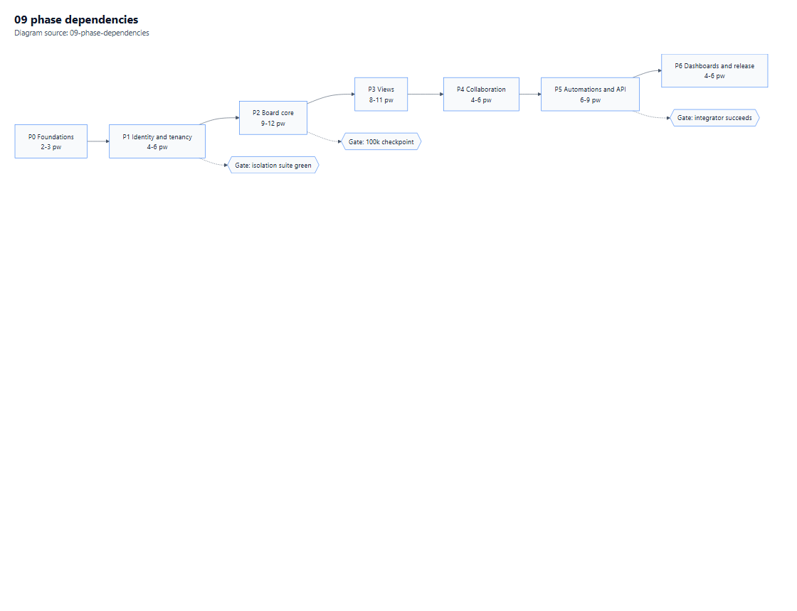

# 12 — Phase Plan Summary

**Purpose.** A human-readable view of the delivery plan. The machine-readable source of truth is [phase-plan.json](phase-plan.json); this manual summarises it and adds the reasoning that does not fit in JSON.

**Depends on:** all manuals · **Index:** [00-Contents.md](00-Contents.md)

**Diagram:** [Phase dependencies](Diagrams/09-phase-dependencies.pdf)

---

## 1. Sequencing logic

*Vector: [09-phase-dependencies.pdf](Diagrams/09-phase-dependencies.pdf) · source: [09-phase-dependencies.mmd](Diagrams/09-phase-dependencies.mmd)*

Three rules produced this order:

1. **Nothing renders before tenancy is proven.** A board page built before tenant isolation exists would need every query rewritten once isolation lands. P1 is deliberately unglamorous and deliberately first.
2. **The grid before the views.** Kanban, calendar, timeline and gantt are all projections of the item model. Building a view before the grid is stable means building it twice.
3. **Automations after collaboration.** Automations produce notifications and updates; building the engine before the notification sink exists means testing against a stub that later changes shape.

P4 and P5 could swap. They are not swapped because notifications are needed as an *action target* in P5, and a stub sink would hide fan-out bugs until later.

---

## 2. Phase table

| Phase | Objective | Slice (runnable) | Effort | Gate |
|---|---|---|---|---|
| **P0** Foundations | A buildable, deployable skeleton with health, logging, CI and configuration | App starts, `/health/ready` green, one static page renders | 2–3 pw | Build + health + one page screenshot |
| **P1** Identity & tenancy | Four roles, tenant isolation, workspaces, board shells | Sign in → create workspace → create board shell → invite viewer → guest gets 404 elsewhere | 4–6 pw | **Isolation suite green** |
| **P2** Board core | Columns, groups, items, subitems, the grid | 8-column board, 3 groups, 500 items, inline edit persists across reload | 9–12 pw | Grid gates + 100k checkpoint |
| **P3** Views | Kanban, Calendar, Timeline, Gantt | Same board in four views, one persisted drag in each | 8–11 pw | Each view a live projection |
| **P4** Collaboration | Updates, notifications, search, attachments | Post an update, reply, notify, find by search | 4–6 pw | Two browsers see each other live |
| **P5** Automations & API | Recipe engine, webhooks, REST API | Worked example recipe fires; external system receives signed webhook | 6–9 pw | Integrator succeeds unaided |
| **P6** Dashboards & release | Widgets, hardening, on-prem packaging | Dashboard with 3 widgets; install, backup, restore, rollback demonstrated | 4–6 pw | Operator installs unaided |
| | **Total** | | **37–53 pw** | |

Effort excludes idle time and assumes one competent full-stack .NET developer ([01](01-Requirements.md) §6.2). A four-person team with a tester lands near 5–7 calendar months.

---

## 3. What every phase must contain

The JSON encodes these; they are repeated here because they are the plan's actual discipline.

| Element | Meaning |
|---|---|
| **Objective** | One sentence: what is true after this phase that was not before |
| **Scope / out of scope** | Explicit, so a phase cannot grow silently |
| **Affected areas** | Projects, modules, tables, components |
| **Dependencies** | Prior phases and open questions that must be answered |
| **Slice** | The smallest end-to-end increment that is runnable |
| **Affected files** | Expected paths, as a planning aid — not a promise |
| **Commands** | What an implementer will run later. None has been run here |
| **Observable checks** | What a person can see and click |
| **Exit criteria** | Binary, evidence-backed conditions |
| **User validation gate** | A human confirms it is usable |

### 3.1 Why every phase has a slice

A phase that only "completes a layer" cannot be demonstrated. Each slice crosses the stack — UI, application, database, and one observable effect — so the phase is proven by use, not by compilation. This is the same rule as [04](04-UI-and-UX-Plan.md) §9: a build is not a behaviour.

---

## 4. Phase detail

### P0 — Foundations

**Objective:** a repository that builds, starts, reports health, logs with correlation, and deploys to both target hosts.

| Area | Work |
|---|---|
| Solution | Seven projects per [02](02-Architecture.md) §3.1, `net10.0`, nullable on, warnings as errors |
| Configuration | Layered config, environment validation on startup (fail fast, not at first request) |
| Data | MySQL container, connection string, migrations harness (no schema yet) |
| Observability | Serilog + correlation id, OpenTelemetry traces, `/health/live` and `/health/ready` |
| CI | Restore, build, unit test, licence scan, secret scan |

**Deliberately not in P0:** any domain code. The temptation to "just start the board table" is how foundations get skipped and tenancy gets retrofitted.

**Exit:** four commands succeed from a clean clone; health green; one page visibly renders.

### P1 — Identity, tenancy, workspaces

**Objective:** four roles, proven isolation, workspaces and board shells.

| Area | Work |
|---|---|
| Identity | OpenIddict server, ASP.NET Core Identity, TOTP MFA, PATs |
| Tenancy | `Account`, `Membership`, tenant context, global filter, write interceptor |
| Authorisation | Permission snapshot, resource policies, capability matrix |
| Workspaces | Workspace, folder, visibility rules, board shell, board grants |
| Security | Circuit security stamp re-validation ([05](05-Security-and-Compliance.md) §2.1) |
| Tests | The eight isolation tests, the full capability matrix |

**Open question that blocks:** Q4 (guest visibility of subitems) — answer before the grant model hardens.

**Exit:** the isolation suite is green and a guest cannot see an ungranted board by any route.

### P2 — Board core

**Objective:** a usable board. This is the largest phase and the one that decides whether the data model was right.

| Area | Work |
|---|---|
| Schema | `Board`, `BoardColumn`, `ItemGroup`, `Item`, `ItemColumnValue`, projections |
| Values | The value writer: JSON + projections, one mutation surface |
| Grid | Virtualisation, inline edit, keyboard model, drag reorder, multi-select |
| Subitems | Child board, own columns, copy-not-sync [S8] |
| Columns | P2 type set (text, numeric, choice, date, people, tags, files-lite) |
| Performance | The 100k checkpoint |

**Exit:** a user builds a real board and works in it for 30 minutes without a blocker; NFR-1 met at 5,000 items.

### P3 — Views

**Objective:** four real projections, each with one persisted interaction.

| Area | Work |
|---|---|
| Kanban | Status grouping, divide-by, empty-lane hiding, cover/card columns [S4] |
| Calendar | Date-column placement, month/week |
| Timeline | Two-date bars, drag reschedule |
| Gantt | Bars + dependency arrows, cycle refusal |
| Remaining columns | `location`, `country`, `doc`, `dependency`, `board_relation`, `checkbox`, `button`, read-only types |

**Exit:** each view reads live data and writes through a drag, with contrast verified on three engines.

### P4 — Collaboration

**Objective:** people can talk about work inside the product.

| Area | Work |
|---|---|
| Updates | Create/edit/delete, sanitisation, replies, likes |
| Notifications | In-app, email, preferences, subscriptions |
| Search | FULLTEXT over names and updates, permission-filtered |
| Files | Attachments, signed URLs, expiry |
| Real-time | Presence, reconnect by version |

**Exit:** two browsers, one update, no refresh, plus a notification arriving within 2 s.

### P5 — Automations, webhooks, API

**Objective:** the product does work by itself and exposes a usable integration surface.

| Area | Work |
|---|---|
| Engine | Trigger registry, condition evaluator, action executor, loop guard, quota |
| Scheduling | Quartz cluster, recurring and date-arrival triggers |
| Webhooks | Registration handshake, signing, retries, auto-disable, SSRF guard |
| API | v1 endpoints, cursor pagination, idempotency, cost model, OpenAPI snapshot |
| Tests | The P5 checklist in [10](10-Acceptance-Checklists.md) §7 |

**Open questions that block:** Q2 (GraphQL), Q3 (timezone semantics).

**Exit:** the worked example fires end-to-end; an external integrator succeeds with docs only.

### P6 — Dashboards, hardening, release

**Objective:** something an operator can install and trust.

| Area | Work |
|---|---|
| Dashboards | Widgets (chart, count, list), permission-aware |
| Hardening | CSP, headers, dependency and licence closure, SBOM |
| Performance | 200-user soak, 5k-board targets |
| Operations | Backup, restore, rollback rehearsal, second-replica checklist, runbooks |
| Packaging | Compose bundle, IIS deployment guide, upgrade procedure |

**Exit:** operator installs from scratch and runs a real workload for a week.

---

## 5. Cross-phase gates

These apply to **every** phase, in addition to its own exit criteria.

| Gate | Applies from | Evidence |
|---|---|---|
| Build clean, warnings as errors | P0 | Build log |
| Unit + integration green | P0 | Test output |
| Isolation suite green | P1 | Suite output |
| UI evidence G-UI-1..7 on changed routes | P1 | Screenshot + console + assets ([04](04-UI-and-UX-Plan.md) §9) |
| Accessibility: no serious/critical on changed pages | P1 | axe output |
| Licence scan clean | P0 | Scan output |
| Clean-room scans clean | P0 | CI output ([11](11-Clean-Room-Protocol.md) §6) |
| No new unlabelled requirement | P0 | PR review against [01](01-Requirements.md) §8 |

---

## 6. What would change the plan

| Change | Effect |
|---|---|
| Q1 resolves as "no commercial licence" | Re-plan the data layer; P2 pauses |
| Pomelo ships EF 10 support | Swap provider in P2; licence risk drops |
| Table-only scope | P3 collapses to 1–2 weeks; total drops to ~L |
| GraphQL added | +2–3 pw in P5 |
| Marketplace added | +12–20 pw; XXL |
| Multi-level subitems become required | +2–3 pw; data model already supports it |

Each of these is a decision, not an engineering surprise, and each is tracked in [09](09-Risks-and-Open-Questions.md).

---

## 7. Reading the JSON

[phase-plan.json](phase-plan.json) carries the same seven phases with machine-readable fields: `id`, `name`, `objective`, `scope`, `outOfScope`, `affectedAreas`, `dependencies`, `slice`, `exitCriteria`, `validationGate`, `manuals`, `diagrams`, `sizeBand`, `estimatedWeeks`.

It is the only file in this set intended to be consumed by tooling. It is not a second summary — if the two disagree, the JSON wins and this manual is corrected.

---

**Next:** [13-Source-Register.md](13-Source-Register.md) records every citation behind these claims.
