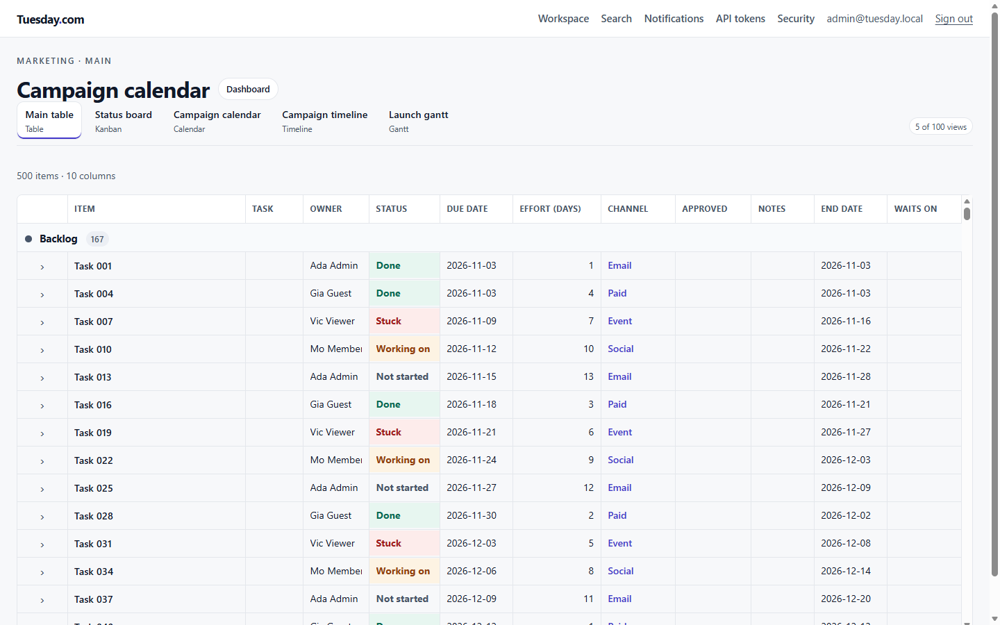
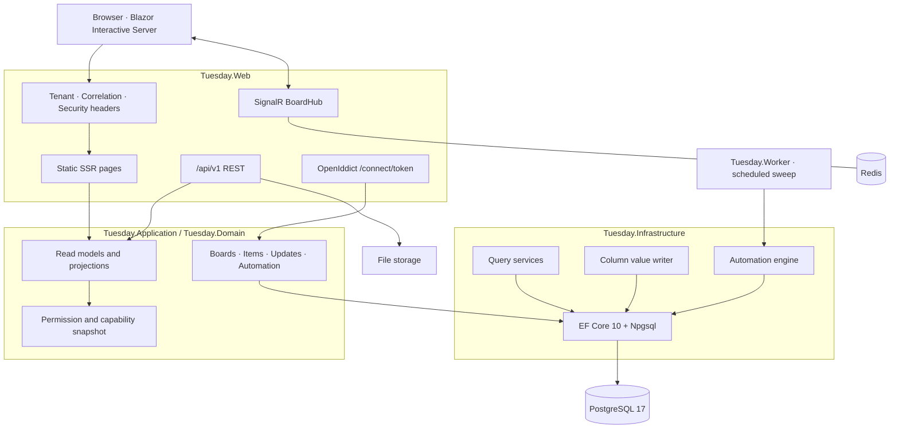
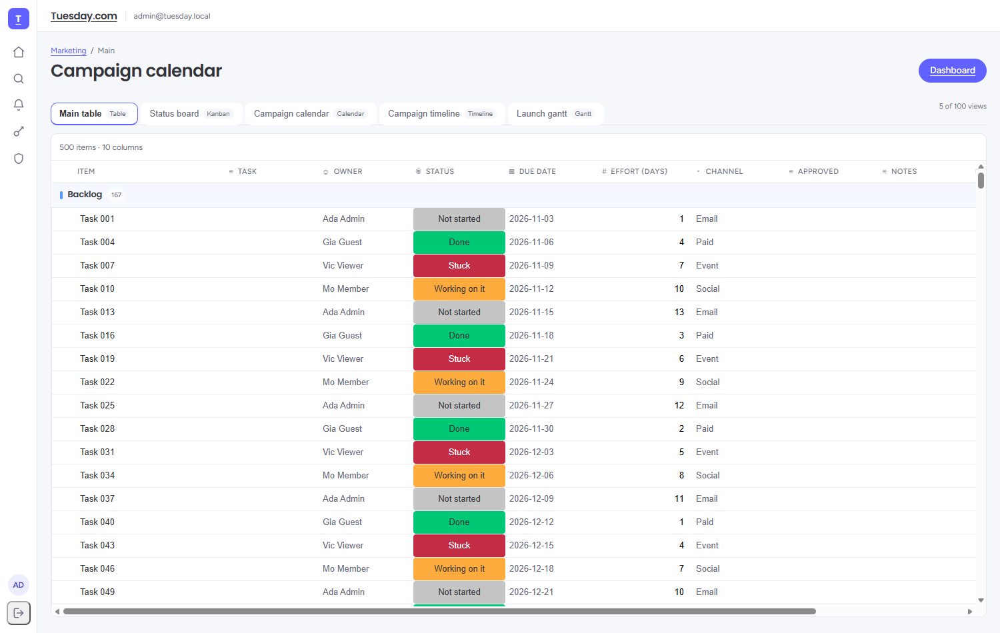

<div align="center">

# Tuesday.com

**A work operating system you can read, audit and run yourself.**

Boards, typed columns, five views, threaded collaboration, automations and a signed public API —
built on .NET 10, PostgreSQL and Blazor.

[](https://dotnet.microsoft.com/)
[](https://github.com/djgene01/tuesday-com/actions/workflows/ci.yml)
[](https://www.postgresql.org/)
[](https://learn.microsoft.com/aspnet/core/blazor/)
[](#testing)
[](#testing)
[](LICENSE)

**[Features](#features) · [Architecture](#architecture) · [Quick start](#quick-start) · [Testing](#testing) · [Roadmap](#roadmap)**

</div>



---

## What this is

Tuesday.com is a clean-room implementation of a **work operating system** — the category of tool
where a team's work lives on boards, every column is typed, every view is a projection of the same
underlying items, and the whole thing is scriptable.

It is not a mockup or a scaffold. It runs: cookie sign-in with a TOTP second factor, an OAuth 2.0
token server, tenant-isolated data access, 500-item boards that virtualise, real-time collaboration
over SignalR, a trigger→condition→action automation engine, HMAC-signed webhooks, and a Docker image
that runs non-root in production.

**Why it exists.** Most work-management tools are closed products you rent. This one is a
permissively licensed codebase you can read end to end, deploy on your own hardware, and change
without asking anyone.

> **Clean-room note.** Tuesday.com reproduces *behaviour*, not assets. No proprietary source,
> trademarks, artwork or internal architecture from any commercial product was used. The rules are
> recorded in [`Development-Plans/11-Clean-Room-Protocol.md`](Development-Plans/11-Clean-Room-Protocol.md).

---

## Features

### Boards and data
- **Typed columns** — status, people, date, number, dropdown and more — each with its own write
  rules and validation. The 500-column ceiling is enforced with a typed error, not a crash.
- **Virtualised grid** — 500 items keep roughly 37 rows in the DOM, so scrolling stays smooth.
  One table, one sticky header, consistent column widths across groups.
- **Five views over one model** — table, kanban, calendar, timeline, gantt. They cannot disagree,
  because they project from the same read model.
- **Inline editing** — Enter commits, Escape reverts, and an in-flight buffer means fast typing
  never drops characters.

### Collaboration
- **Threaded updates** with a whitelist HTML sanitiser on every write: `<script>`, `onclick`,
  `javascript:` links, images and style attributes cannot be stored, let alone served.
- **Real-time fan-out** over SignalR, with board joins gated by the same visibility rules as REST.
- **Notifications**, per-user email preference, likes, mentions and in-app search.
- **Attachments** streamed through short-lived DataProtection-signed tickets — no anonymous file
  URLs.

### Security and identity
- **ASP.NET Core Identity** cookie sign-in with **TOTP two-factor**: enrolment, verification and
  10 one-time recovery codes.
- **OpenIddict OAuth 2.0** authorization server at `/connect/token` — password, refresh and
  client-credentials grants. A password grant for an MFA account is *refused*, never silently
  downgraded.
- **Bearer authentication** on `/api/v1` accepts both OAuth access tokens and hand-issued API
  tokens.
- **Tenant isolation** enforced by EF Core global query filters, backed by a dedicated 38-test suite
  that tries to break out of them.

### Automation and integration
- **Rules**: trigger (`CellChanged`, `DatePassed`, `UpdatePosted`) → condition → action
  (`SetStatus`, `SetDate`, `NotifyOwner`).
- **Scheduled sweep** for overdue work, deduped per item per day so a minute-by-minute scan never
  becomes spam.
- **Signed webhooks** with a challenge handshake and HMAC-SHA256 dispatch.
- **Public REST API** over the same read models the UI uses.

### Operations
- `/health/live` (dependency-free) and `/health/ready` (database, Redis, storage — per-check
  timeouts, JSON detail).
- Correlation ids on every request and log line, structured logging, OpenTelemetry traces.
- Security headers, non-root container, multi-stage build, health-gated Compose stack.
- A signing-certificate runbook with expected results and a rollback line per step.

---

## Architecture



**Layering.** `Domain` holds entities and rules with no framework references. `Application` owns
read models, projections and the permission snapshot. `Infrastructure` owns persistence, caching,
storage and services. `Web` and `Worker` are hosts.

The rule that keeps this honest: **views never mutate.** A drag or a keypress hands the change to
the value writer, and every view redraws from the result.

One deliberate choice worth naming: interactive circuits can run two handlers at once, and a scoped
`DbContext` cannot survive that. Every write and grid read takes a fresh context from
`IDbContextFactory`, which is why a double-fired edit can never truncate a concurrent one.

---

## Tech stack

| Layer | Choice | Why |
|---|---|---|
| Runtime | **.NET 10 LTS** | The only supported stable release in this window |
| UI | **Blazor Web App** — Interactive Server for dense surfaces, static SSR for auth and shell | The grid needs a persistent circuit; the login form must not have one |
| Database | **PostgreSQL 17** via `Npgsql.EntityFrameworkCore.PostgreSQL` (MIT) | Chosen over MySQL, whose EF provider is GPLv2-with-FOSS-exception |
| ORM | **EF Core 10**, with Dapper for reporting reads | Migrations for schema, hand-written SQL where projections get hot |
| Identity | **ASP.NET Core Identity** + **OpenIddict 7** | Cookie auth for people, OAuth for machines |
| Realtime | **SignalR**, in-process broadcast | No broker needed for single-node deployment |
| Cache | **Redis** | Read caching, and the backplane when a second replica lands |
| Sanitising | **HtmlSanitizer** (MIT) | Allow-list, not block-list |
| Styling | **Tailwind CSS v4** with a token layer (`@theme`) | One source of truth for colour, type and shape; no bespoke component CSS |
| Type | **Poppins** + **Figtree**, self-hosted | Display and UI faces, served from `wwwroot/fonts` — no CDN call |
| Packaging | **Docker** multi-stage, non-root, Compose | On-prem, Windows Server or Linux |

### Design

The interface follows monday.com's visual language — violet primary, soft grey canvas,
pill actions, a compact grid with solid status cells. Whatever the inspiration, the
assets are ours: a plain "T" mark, hand-written SVG icons, and open-licence fonts.



Tokens, component rules and the accessibility table live in **[docs/DESIGN.md](docs/DESIGN.md)**.

The published API — auth, cursor pagination, idempotency, quotas and webhook delivery rules —
is documented in **[docs/API.md](docs/API.md)**.

---

## Quick start

### With Docker (recommended)

```bash
git clone https://github.com/djgene01/tuesday-com.git
cd tuesday-com

cp docker/.env.example docker/.env          # fill in every CHANGE ME
# generate the IdP signing certificate: docs/runbooks/signing-certificate.md §1

docker compose -f docker/compose.release.yaml --env-file docker/.env up -d --build
curl -s http://127.0.0.1:8080/health/ready
```

Then open <http://127.0.0.1:8080>. The seeded demo workspace signs in with
`admin@tuesday.local` / `Tuesday!Demo1` — **development credentials; change them before exposing
anything.**

> **Verify it actually works, not just that it is up.** Load the board page and confirm
> `/_framework/blazor.web.js` returns `200 text/javascript`. A health check alone once hid an image
> with no Blazor framework files at all.

### From source

Requires the .NET 10 SDK (pinned in `global.json`), plus PostgreSQL and Redis.

```bash
docker compose -f docker/compose.yaml up -d      # dependencies only

dotnet restore Tuesday.slnx
dotnet build   Tuesday.slnx -c Release
dotnet test    Tuesday.slnx -c Release
dotnet run --project src/Tuesday.Web             # http://127.0.0.1:5205
```

Development configuration lives in `src/Tuesday.Web/appsettings.Development.json` and uses
`127.0.0.1`, **not** `localhost` — on Windows `localhost` resolves to `::1` first while Docker
publishes on IPv4 only, which shows up as a 2-second timeout. Production values come from the
environment, and the app fails at start-up rather than at first use when one is missing.

---

## Testing

```bash
dotnet test Tuesday.slnx -c Release
```

| Suite | Tests | What it pins down |
|---|---:|---|
| `Tuesday.Tests.Unit` | 52 | Capability matrix, view projections, sanitiser, automation rule grammar, DI wiring |
| `Tuesday.Tests.Isolation` | 38 | Cross-tenant access, projection consistency, dependency graphs, update threads |
| `Tuesday.Tests.Integration` | 13 | Real pipeline boot, token issuance, MFA-gated grants, 404 rendering, API status codes |
| **Total** | **103** | Warning-free build; `TreatWarningsAsErrors` is on |

The isolation suite is the one to read first. It does not test that tenancy *works*; it tries to
prove that it does **not**, by asking for rows it should never see.

---

## Project layout

```
src/
  Tuesday.Domain          Entities and rules, no framework references
  Tuesday.Application     Read models, projections, permission snapshot
  Tuesday.Infrastructure  EF Core, Redis, storage, query and automation services
  Tuesday.Contracts       DTOs shared with API clients
  Tuesday.Web             Blazor app, REST API, OAuth server, SignalR hub
  Tuesday.Worker          Scheduled automation sweep
tests/
  Tuesday.Tests.Unit      Fast, no I/O
  Tuesday.Tests.Isolation Tenancy and projection invariants
  Tuesday.Tests.Integration Boots the real web pipeline
docs/
  runbooks/               Operational procedures with expected results
  assets/                 Screenshots used above
  STATUS.md               Phase-by-phase status and design notes
Development-Plans/        Requirements, architecture, data model, phase plan, risk register
```

---

## Roadmap

This is **0.9.0**, a release candidate. The honest limit list is in
[`RELEASE-NOTES.md`](RELEASE-NOTES.md), and every open item maps to a gate in
[`Development-Plans/10-Acceptance-Checklists.md`](Development-Plans/10-Acceptance-Checklists.md).

| Area | Status |
|---|---|
| Boards, groups, typed columns, virtualised grid | ✅ shipped |
| Five views — table, kanban, calendar, timeline, gantt | ✅ shipped |
| Collaboration, attachments, notifications, search | ✅ shipped |
| Automations, scheduled sweep, webhooks, REST API | ✅ shipped |
| Identity, TOTP, OAuth 2.0 token server, API tokens | ✅ shipped |
| Dashboard, health, logging, security headers, container | ✅ shipped |
| Sub-items | ✅ inline expander, own column set with its own editor |
| Drag reorder in the table grid | ✅ pointer drag and Alt+Arrow, including sub-item panels |
| Performance checkpoints | ✅ 5k: p95 136 ms · 100k: p95 1.77 s (`scripts/perf`) |
| Cursor pagination, idempotency keys, SSRF guard, webhook retries | ✅ shipped |
| Nonce-based CSP, CycloneDX SBOM with reviewed allowlist, backup/restore drill | ✅ shipped |

---

## Contributing

Issues and pull requests are welcome. Before opening a PR:

```bash
dotnet build Tuesday.slnx -c Release   # must stay at zero warnings
dotnet test  Tuesday.slnx -c Release   # must stay green
```

Two house rules: **every numeric value rendered into markup uses `CultureInfo.InvariantCulture`** (a
decimal comma in an SVG path breaks the page), and **new behaviour needs a test that would fail
without it**.

---

## Licence

[MIT](LICENSE) © 2026 djgene01

Use it, fork it, sell it, ship it. If you build something on it, a link back is appreciated but not
required.
